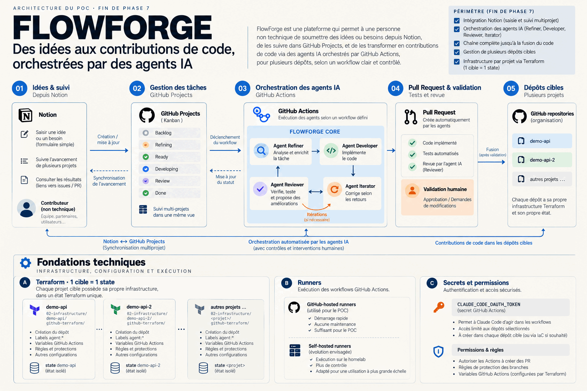

# 🔥 FlowForge

> **Status: experimental proof of concept, version `v0.1.0`.** Validated live on two target
> repositories (`demo-api`, `demo-api-2`), with reservations listed in the
> [milestones](docs/milestones/). Nothing here is production-ready.
>
> **New here?** Go to **[GETTING_STARTED.md](GETTING_STARTED.md)** to connect a repository.

FlowForge is a **central GitHub repository** that runs AI coding agents (Claude Code) on other
GitHub repositories, called *targets*. A need becomes a refined Issue, then a tested **Draft pull
request**. A human validates that PR and merges it.

------

## 📖 What FlowForge is

### The problem

Using a coding agent on one repository is easy. Using it on **many** repositories leads to:

- copies of the same workflows, prompts and rules that drift apart in every repository;
- labels, permissions and branch protections configured by hand, different in each one;
- no single place to improve the agents or tighten their permissions;
- agents that judge a change against the Issue and the code only, with no record of what the
  product is supposed to do.

### The approach: 1 FlowForge → N targets

| FlowForge provides, once | Each target keeps |
|---|---|
| reusable GitHub Actions workflows (`workflow_call`) | its code, tests and CI |
| generic agent rules ([`agents/`](agents/)) | its `CLAUDE.md`: stack, commands, conventions |
| a Terraform module that configures an existing repository | its `SPEC.md`: the functional contract |
| caller templates ([`examples/target-repository/`](examples/target-repository/)) | five thin callers, pinned to one FlowForge version |

**Technologies**: GitHub Issues, GitHub Actions, GitHub Projects, GitHub Apps, Terraform
(`integrations/github` provider), Claude Code through
[`anthropics/claude-code-action`](https://github.com/anthropics/claude-code-action), Bash. A
Notion intake is optional.

### What FlowForge does not do

- It does not **merge**, approve, mark a PR ready, or enable auto-merge. Agents open Draft PRs only.
- It does not **start by itself**. Every agent run starts with a human action: a dispatched
  workflow, or the `agent:ready` label applied by a human. Moving a Project card, or editing
  Notion, never starts an agent.
- It does not **decide what the product should do**. Agents cite `SPEC.md` and ask; contract
  decisions belong to the project owner.
- It does not **create or delete** repositories, and it manages no secret in Terraform.
- It does not replace the target's CI.

------

## 🔀 How it works

```text
 Request ─► Refiner ─► human: agent:ready ─► Developer ─► Draft PR ─► Reviewer ⇄ Iterator
 (Issue)    (on demand)                      (SPEC.md gate)            (≤ 3 Iterator passes)
                                                                              │
                         Done ◄── agent:done ◄── merge ◄── human validation ◄─┘
```

| Agent | What it does | What it never does |
|---|---|---|
| **Refiner** | rewrites a raw Issue into an executable one: goal, scope, acceptance criteria, Definition of Done, `SPEC.md` impact, open questions | write code, apply `agent:ready`, settle a contradiction with `SPEC.md` |
| **Developer** | checks `SPEC.md`, implements the Issue with tests on `agent/<issue>-<slug>`, updates `SPEC.md` only when the Issue says so | push to the default branch, open anything but a Draft PR |
| **Reviewer** | read-only: checks the PR against the Issue, `SPEC.md`, the code, the tests and CI; verdict `APPROVE` / `REQUEST_CHANGES` / `BLOCKED` | commit, approve in GitHub, merge |
| **Iterator** | fixes the Reviewer's findings on the same PR branch, then hands back to the Reviewer | anything beyond the findings |

**The project owner** validates `SPEC.md`, answers the Refiner's questions, checks the acceptance
criteria and the Definition of Done, applies `agent:ready`, and approves and merges the PR.

**`SPEC.md`** is the target's functional contract: features `F-xxx`, rules `R-xxx`, validation
scenarios `S-xxx`. The Refiner classifies each request against it (`COMPLIANT`, `NEW_FEATURE`,
`CONTRADICTS`, …). The Developer refuses to start without a valid one, and the Reviewer checks
the PR against it. See the [contract](docs/spec-contract.md).

**Acceptance criteria and Definition of Done** are written by the Refiner, validated by the
owner before `agent:ready`, implemented by the Developer and checked one by one by the Reviewer.
See the [refined Issue contract](docs/issue-contract.md).

**GitHub Projects** gives a visual status per request. The workflows write it, one way:
`Backlog → Refining → Ready → Developing → Review ⇄ Iteration → Human validation → Done`, plus
an `Attention` field when a human must act. The board never drives the agents.

------

## ✅ Features (implemented and validated live)

| Capability | Validated on | Details |
|---|---|---|
| Developer: Issue + `agent:ready` → Draft PR with tests | `demo-api` | [architecture §2.2](docs/architecture.md) |
| Reviewer, read-only, with structured findings and a verdict | `demo-api` | [phase 3](docs/milestones/phase3-reviewer-e2e.md) |
| Review cycle Reviewer ⇄ Iterator, bounded to 3 Iterator passes | `demo-api` | [phase 4](docs/milestones/phase4-iterator-e2e.md) |
| One `agent:*` state label per Issue, `agent:done` after a human merge | `demo-api` | [phase 4.1](docs/milestones/phase41-hardening-e2e.md) |
| Human merge gate enforced by a GitHub ruleset | `demo-api`, `demo-api-2` | [architecture §2.7](docs/architecture.md#27-human-merge-gate-phase-41) |
| Delivery by a FlowForge GitHub App (target CI runs on agent PRs) | `demo-api`, `demo-api-2` | [architecture §2.10](docs/architecture.md) |
| Refiner with `READY` / `NEEDS_CLARIFICATION` / `BLOCKED` | `demo-api`, `demo-api-2` | [phase 5](docs/milestones/phase5-refiner-e2e.md) |
| GitHub Project status, written by the workflows | `demo-api`, `demo-api-2` | [phase 6](docs/milestones/phase6-github-projects-e2e.md) |
| Optional Notion intake and status feedback | `demo-api`, `demo-api-2` | [phase 7](docs/milestones/phase7-notion-complete.md) |
| `SPEC.md` contract gate before the Developer | `demo-api` (`PASS` path) | [spec-contract.md](docs/spec-contract.md) |
| Requests refined against `SPEC.md` (`spec_impact`, cited items, DoD) | `demo-api`, `demo-api-2` | [phase 8](docs/milestones/phase8-specification-complete.md) |
| Versioned consumption: module by Git tag, callers by full commit SHA | `demo-api`, `demo-api-2` | [onboarding §10](docs/target-onboarding.md) |

What was **not** observed live (for example the gate's `FAILED` path in a real run, or some
Iterator rules) is listed as reservations in each milestone and in the
[Phase 8 closure](docs/milestones/phase8-specification-complete.md).

------

## 🚀 Quick start

The full procedure is in **[GETTING_STARTED.md](GETTING_STARTED.md)**. In short:

1. **Organization, once**: the FlowForge GitHub App, the secret `CLAUDE_CODE_OAUTH_TOKEN`, App
   credentials, and optionally the organization Project.
2. **`SPEC.md`**: run the [preparation mission](docs/preparation-projet-existant-pour-flowforge.md)
   in the target, check it with `.github/scripts/flowforge-spec.sh`, and have the owner validate
   and merge it.
3. **Terraform**: instantiate `terraform/modules/target-repository` with
   `?ref=v0.1.0`, in one state, then review the plan before applying.
4. **Callers**: copy the five files of `examples/target-repository/`, pinned to the full SHA of
   `v0.1.0`.
5. **Checks**: run the readiness checks R1–R18 until none is `FAIL`.
6. **First request**: open an Issue, run `flowforge-refine.yml`, validate the result, apply
   `agent:ready`, run `flowforge-review-cycle.yml` on the Draft PR, then review and merge.

------

## 🏗️ Architecture



```text
 target repository                                  FlowForge (this repository)
 ─────────────────                                  ───────────────────────────
 .github/workflows/flowforge-*.yml  ── uses @SHA ─►  .github/workflows/agent-*.yml, review-cycle.yml
 CLAUDE.md, SPEC.md, code, CI                         .github/scripts/  (state, SPEC gate, Project sync)
 labels + ruleset  ◄── Terraform module ───────────  terraform/modules/target-repository
                                                     agents/*.md      (rules, fetched at the same SHA)
```

Reusable workflows run in the **caller's** context (its repository and token). A run on one
target can never write to another. Details:
[docs/architecture.md](docs/architecture.md).

------

## 📚 Documentation

| Document | Content |
|---|---|
| [GETTING_STARTED.md](GETTING_STARTED.md) | practical guide: onboard a repository and run a first request |
| [docs/target-onboarding.md](docs/target-onboarding.md) | detailed onboarding reference: readiness checks R1–R18, permissions, versions and updates |
| [docs/spec-contract.md](docs/spec-contract.md) | the `SPEC.md` contract, the gate, how agents use it |
| [docs/issue-contract.md](docs/issue-contract.md) | refined Issue format, *Ready* definition, labels |
| [docs/preparation-projet-existant-pour-flowforge.md](docs/preparation-projet-existant-pour-flowforge.md) | mission to prepare `SPEC.md` in an existing target (French) |
| [docs/architecture.md](docs/architecture.md) | components, flows, contract with targets, security model |
| [agents/](agents/) | rules of the Refiner, Developer, Reviewer and Iterator |
| [docs/github-projects/](docs/github-projects/) | Kanban model, provisioning, synchronization |
| [docs/notion/](docs/notion/) | optional Notion intake: model, provisioning, submission, feedback |
| [terraform/modules/target-repository/README.md](terraform/modules/target-repository/README.md) | module inputs, labels, ruleset, token permissions |
| [docs/milestones/](docs/milestones/) | live validations, evidence and reservations, phase by phase |

------

## ⚠️ Limitations

- **Experimental.** `v0.1.0` has no stability guarantee; a later `0.x` version may change inputs,
  labels or behaviour.
- **GitHub setup required.** The setup needs an organization, an organization owner for the App,
  secrets and variables, and Terraform for each target. Rulesets on private repositories need a
  paid GitHub plan, which is why the POC targets are public.
- **Humans stay in the loop.** A human starts every refinement and review, applies `agent:ready`,
  approves and merges. Nothing runs fully autonomously.
- **Agents judge, the code checks structure.** The `SPEC.md` gate checks the file's structure,
  not its meaning. Whether a change agrees with the contract is the agents' judgement, reviewed
  by a human.
- **POC specifics.** The FlowForge App is installable in its own organization only. Agents cannot
  change `.github/workflows/`. Project sync is best-effort. Only Python / uv targets have been
  exercised.
- **Not verified live.** Some paths are tested offline only, see the milestones' reservations.

------

## 🛠️ Development of FlowForge itself

```bash
pre-commit install            # once
pre-commit run --all-files    # YAML/JSON, private keys, terraform fmt/validate/test, actionlint, tests/*.sh
```

The same hooks run in CI (`.github/workflows/ci.yml`) on every pull request and on pushes to
`main`. Conventions and repository layout: [CLAUDE.md](CLAUDE.md).

### 🗺️ History

| Phase | Result |
|---|---|
| 1–2 Foundation, Developer E2E | ✅ tag `flowforge-phase2-e2e` |
| 3 Reviewer | ✅ tag `flowforge-phase3-reviewer-e2e` |
| 4 / 4.1 Iterator, hardening, merge gate | ✅ with reservations, tags `flowforge-phase4-iterator-e2e`, `flowforge-phase4.1-hardening-e2e` |
| 5 Refiner | ✅ with reservations, tag `flowforge-phase5-refiner-e2e` |
| 6 GitHub Projects | ✅ with reservations, tag `flowforge-phase6-github-projects-e2e` |
| 7 Notion | ✅ with reservations, tag `flowforge-phase7-notion-e2e` |
| 8 Specification (`SPEC.md`), onboarding, `v0.1.0` | ✅ with reservations ([closure](docs/milestones/phase8-specification-complete.md)) |

**Not implemented**: QA agent, Documentation agent, self-hosted runners, automatic Refiner
triggers, a GitHub Project reconciliation job.

------

## 🔐 Security

No token or secret is ever committed. Terraform reads `GITHUB_TOKEN` from the environment and
never manages Actions secrets. Workflows start from `permissions: {}`, and Issue content is
treated as untrusted input. Agents open Draft PRs only, and a default-branch ruleset requires a
human to merge. See [docs/architecture.md §4](docs/architecture.md#4--security-model).

## 💡 Inspiration

FlowForge is inspired by [big-emotion/ferry](https://github.com/big-emotion/ferry), a GitHub
Actions–native agent pipeline that turns Jira column moves into reviewed draft PRs. Ideas
borrowed: specialized agents (Refiner, Developer, Reviewer, Iterator) and Draft PRs that agents
never merge. FlowForge reimplements them independently on GitHub Issues, with one central
repository serving several targets. No ferry code is included.

## 📄 License

[MIT](LICENSE)
