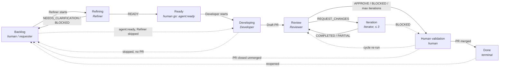

# 🗂️ FlowForge — GitHub Project / Kanban model

> **Status**: model defined (Phase 6, Prompt 26). **Nothing is created or automated yet**: no
> GitHub Project exists, no field is created through the API, no workflow syncs a status.
> Prompt 27 creates and configures the Project from this document; Prompt 28 adds the
> synchronisation from the workflows (§14).
>
> **Prerequisites**: [architecture.md §2.6](../architecture.md#26-issue-label-lifecycle-phase-41)
> (state labels), §2.5 (review cycle), §2.9 (Refiner), [issue-contract.md](../issue-contract.md).
>
> **Unchanged by this document**: agents, agent rules, workflows, state labels, Terraform.

------

## 🧠 Mental Model

```text
  GitHub Project  = WHERE is each need?        (visual, global, cross-repository)
  GitHub Issue    = WHAT is the work?          (unit of work: one Issue = one card)
  agent:* labels  = WHAT may run next?         (triggers, guards, execution state)
  Actions runs    = WHAT actually happened?    (execution truth)

  workflow event ──► state label (unchanged, today)
                └──► Project Status + Attention (Prompt 28)     one-way, never back
```

| Question | Answered by |
|---|---|
| Where is need X in the flow? | Project `Status` |
| Does a human have to act, and why? | Project `Attention` (+ `Human validation` column) |
| Can the Developer start? | label `agent:ready` (human), never the card position |
| Did the run really succeed? | the Actions run, `review.json` / `iteration.json` / `cycle.json` |

------

## 📑 Table of contents

1. [Role of the Project](#1--role-of-the-project)
2. [Target Project](#2--target-project)
3. [Statuses](#3--statuses)
4. [Fields](#4--fields)
5. [Labels ↔ statuses](#5--labels--statuses)
6. [Source of truth](#6--source-of-truth)
7. [Transitions](#7--transitions)
8. [Errors](#8--errors)
9. [Human actions](#9--human-actions)
10. [Multi-repository](#10--multi-repository)
11. [Future automation (Prompt 28)](#11--future-automation-prompt-28)
12. [Future integration: Notion](#12--future-integration-notion)
13. [Diagram](#13--diagram)
14. [Hand-off to Prompts 27 and 28](#14--hand-off-to-prompts-27-and-28)

------

## 1. 📖 Role of the Project

The GitHub Project is FlowForge's **operational and visual steering layer**: one board that
shows, across every target repository, where each need stands in the FlowForge flow and
which ones wait for a human.

| Layer | Role | Changed by |
|---|---|---|
| GitHub Project | Global workflow state, cross-Issue and cross-repository view | FlowForge workflows (Prompt 28); humans for human-owned moves (§9) |
| GitHub Issue | Unit of work: the need, its refined specification, its history | Requester, Refiner workflow |
| `agent:*` labels | Technical signals: Developer trigger (`agent:ready`), guards of every transition, current execution state | Workflows via `flowforge-state.sh`; `agent:ready` by a human only |
| FlowForge agents | Do the work: refine, develop, review, iterate | Reusable workflows |

The Project **complements** the labels, it does not replace them: every workflow guard keeps
reading labels (a `GITHUB_TOKEN` cannot even read an organization Project), and the Project is
finer than the labels where the labels deliberately stay coarse (`Refining`, `Iteration`,
`Human validation` have no label of their own, §5).

------

## 2. 🎯 Target Project

| Item | Decision |
|---|---|
| Name | **`FlowForge Development`** |
| Owner | Organization **`TiPunchLabs`** (organization-level Project). A repository-level Project cannot hold Issues of several repositories |
| Visibility | **Private** by default; items of private repositories stay visible only to people who can read them |
| Repositories | Every onboarded target (`demo-api` today) and FlowForge itself if wanted. Only repositories owned by `TiPunchLabs` can be added |
| Items | **Issues only** — one card per Issue. Pull requests are **not** added as items: they appear on the Issue card through the built-in `Linked pull requests` field. Draft items are not used (an agent needs a real Issue) |
| Number of Projects | **One** reference Project for all targets. A per-target Project would split the global view this layer exists for |

**When an Issue enters the Project.** Either a human adds it (or a built-in *Auto-add*
workflow, configured per repository in Prompt 27), or the first FlowForge event about it adds
it (Prompt 28: adding an Issue already in the Project is a no-op). An Issue never handed to
FlowForge may live in the Project as `Backlog`; FlowForge ignores it until a human starts the
Refiner or applies `agent:ready`.

------

## 3. 🚦 Statuses

One single-select field **`Status`** (the Project's built-in Status field, options replaced),
in this order:

```text
Backlog → Refining → Ready → Developing → Review ⇄ Iteration → Human validation → Done
```

| Status | Meaning | Owner | Entry | Exit | Kind |
|---|---|---|---|---|---|
| **Backlog** | Raw need, or need waiting for its requester / a human decision before development | Human (requester) | Issue created or added; Refiner `NEEDS_CLARIFICATION` or `BLOCKED`; Developer stopped without PR; PR closed unmerged; Issue reopened | Refiner starts → `Refining`; human applies `agent:ready` → `Ready` / `Developing` | Stable, initial |
| **Refining** | A Refiner run is in progress on the Issue | **Refiner** | `agent-refine.yml` refine job starts | Verdict published: `READY` → `Ready`; `NEEDS_CLARIFICATION` / `BLOCKED` → `Backlog` | Transient |
| **Ready** | Executable Issue (Refiner `READY`, or written to the contract by hand): waits for the human go, or the go was just given | **Human** (go), Refiner proposes | Refiner `READY`; human applies `agent:ready` | Developer starts → `Developing` | Stable |
| **Developing** | The Developer works on the Issue | **Developer** | Developer preconditions passed (`agent:running`) | Draft PR delivered → `Review`; agent stopped without PR → `Backlog` | Transient |
| **Review** | A Draft PR exists; agent review pending (cycle not started yet) or running | **Reviewer** | Draft PR delivered (`agent:review`); Reviewer #k starts; Iterator done | Cycle verdict: `REQUEST_CHANGES` → `Iteration`; `APPROVE` / `BLOCKED` / budget spent → `Human validation` | Transient |
| **Iteration** | The Iterator fixes the Reviewer findings on the PR branch | **Iterator** | Iterator #k starts | `COMPLETED` / `PARTIAL` → `Review`; `BLOCKED` → `Human validation` | Transient, bounded (≤ 3, §2.5) |
| **Human validation** | Agents are done with the PR; only a human can decide: approve and merge, ask again, or abandon | **Human** | Cycle result `APPROVED`, `BLOCKED` or `MAX_ITERATIONS_REACHED` | PR merged → `Done`; cycle re-dispatched → `Review`; PR closed unmerged → `Backlog` | Stable |
| **Done** | The work is merged (or a human closed the Issue as completed) | — (lifecycle workflow) | PR merged (`agent:done`); Issue closed as *completed* | Issue reopened → `Backlog` (only exit) | **Terminal** |

### 3.1 🧭 Status definitions

**Backlog.** Ideas, needs, Issues created by hand, imported, or (later) coming from Notion,
not refined yet *or* parked: a Refiner question waits for the requester, a block waits for a
human decision, an agent stopped, a PR was abandoned. *Why* it is parked is shown by
`Attention` (§4), not by an extra column. Main exit: `Backlog → Refining`.

**Refining.** Exactly "a Refiner run is in progress". It has no label (the Refiner never
labels during its run, contract §6), so only the Project can show it.

> 💡 **Note — `Needs clarification`: column or not?** Compared on purpose:
>
> | | Separate `Needs clarification` column | `Backlog` + `Attention = Needs clarification` (**retained**) |
> |---|---|---|
> | Visibility | One column | One field value: badge on the card, filter, group-by |
> | Meaning | Duplicates the label `agent:needs-clarification` | Same information, label unchanged |
> | Board | 9th column, often empty | 8 columns, as the flow |
> | Next step | Requester answers, then Refiner again | Same |
>
> The Issue does not progress while it waits: it is back in the requester's hands, which is
> what `Backlog` means. The *reason* belongs to `Attention`, so the same mechanism also covers
> `Blocked` and `Failed` without adding a column per reason.

**Ready.** Clear Issue with acceptance criteria and no blocking ambiguity
([Ready definition](../issue-contract.md#5--ready-definition)). The **human gate stays the
label**: a card in `Ready` without `agent:ready` waits for the human go; applying `agent:ready`
starts the Developer within seconds. Moving the card never starts anything (§6).

**Developing.** Entered on the real start of the Developer (preconditions passed, label
`agent:running`), never on the label `agent:ready` alone. Main exit: `Developing → Review`.

**Review.** The Draft PR exists. The review cycle is started by a human today
(`workflow_dispatch`, architecture §6 open decision), so `Review` also covers "PR delivered,
cycle not started yet". A stand-alone `flowforge-review.yml` run changes no status, exactly as
it changes no label: only the cycle owns the decision.

**Iteration.** Bounded by the review cycle (`max_iterations ≤ 3`, unrolled jobs): the board can
go `Review → Iteration → Review` at most three times per cycle. This document does not change
the bound.

**Human validation.** `APPROVED` is not `Done`: the PR is still Draft, unmerged and protected by
the ruleset (architecture §2.7). The card also lands here when the agents cannot conclude
(`BLOCKED`, `MAX_ITERATIONS_REACHED`), with `Attention` telling which. Backward exits are allowed
and expected: a human can re-run the cycle (`→ Review`) or close the PR (`→ Backlog`).

**Done.** Terminal. Criteria: PR merged by a human, Issue closed by `Closes #n`, label
`agent:done`, no agentic work left. An Issue closed by hand **as completed** (work done outside
FlowForge) is `Done` too. An Issue closed **as not planned** is not `Done`: it is archived from
the board (§9). Only a reopen moves a card out of `Done`.

### 3.2 🛑 `BLOCKED` behaviour

`BLOCKED` is an **agent result** meaning "a human decision is required"; it is never a column.

| Who returns `BLOCKED` | Is there a Draft PR? | Status | `Attention` | Label (unchanged behaviour) |
|---|---|---|---|---|
| Refiner | no | `Backlog` | `Blocked` | unchanged (reason commented) |
| Developer (agent stopped, no Draft PR) | no | `Backlog` | `Blocked` | `agent:blocked` |
| Reviewer or Iterator (cycle `BLOCKED`) | yes | `Human validation` | `Blocked` | `agent:blocked` |
| Cycle `MAX_ITERATIONS_REACHED` | yes | `Human validation` | `Max iterations` | `agent:blocked` |

Rule: **with a PR, the decision is about the PR → `Human validation`; without a PR, the decision
is about the need → `Backlog`.** A `BLOCKED` set by a *workflow* (`produced_by: workflow`) is a
technical failure, never a business block (§8).

------

## 4. 🧾 Fields

Kept to the minimum: two custom fields are required, the rest is built in or deferred.

| Field | Type | Values | Verdict | Why |
|---|---|---|---|---|
| `Status` | single select (built-in, options replaced) | the 8 statuses of §3 | **Required** | The flow itself |
| `Attention` | single select (custom) | *empty*, `Needs clarification`, `Blocked`, `Max iterations`, `Failed` | **Required** | Why a human must act; keeps errors and blocks out of the columns (§3.2, §8) |
| `Repository` | built-in | — | **Required** (nothing to create) | Distinguish targets, group by repository (§10) |
| `Labels`, `Linked pull requests`, `Assignees` | built-in | — | **Required** (nothing to create) | Show `agent:*` labels and the Draft PR on the card |
| `Priority` | single select (custom) | `P0`, `P1`, `P2`, `P3` | **Useful** | Order `Backlog` and `Ready`; human-owned, never read by agents |
| `Type` | built-in (organization Issue types) | as defined by the organization (e.g. `Feature`, `Bug`, `Task`) | **Useful** | Uses GitHub's Issue types rather than a custom field; nothing to create in the Project. Organization Issue types are configured outside FlowForge |
| `Agent` | — | `Refiner` … `Human` | **Rejected** | Fully derived from `Status` (§3 *Owner* column): a second field would drift |
| `Iteration count` | number | 0–3 | **Future** | Already in `cycle.json`; worth a field only if reporting needs it |
| `Risk` | single select | `Low` / `Medium` / `High` | **Future** | No agent produces a risk assessment today |

**`Attention` values.**

| Value | Set when | Cleared when |
|---|---|---|
| *empty* | the flow proceeds normally | — |
| `Needs clarification` | Refiner `NEEDS_CLARIFICATION` | next FlowForge event on the Issue (e.g. Refiner runs again) |
| `Blocked` | an agent returned `BLOCKED` (§3.2) | next FlowForge event, or a human clears it after deciding |
| `Max iterations` | cycle `MAX_ITERATIONS_REACHED` | next FlowForge event |
| `Failed` | technical failure of a FlowForge run (§8) | next FlowForge event (the re-run) |

Every FlowForge event writes **both** `Status` and `Attention` (empty unless stated), so a stale
`Attention` never survives a later event.

------

## 5. 🔖 Labels ↔ statuses

**What exists today** (Terraform module `target-repository`, `flowforge-state.sh`): six state
labels, at most one per Issue.

| Label | Exists | Role | Status |
|---|---|---|---|
| *(no state label)* | — | Not handed to FlowForge, or handed back | `Backlog`, `Refining`, `Ready` (after Refiner `READY`) |
| `agent:needs-clarification` | ✅ | State: Refiner waits for the requester | `Backlog` + `Attention = Needs clarification` |
| `agent:ready` | ✅ | **Trigger** of the Developer (human only) + state | `Ready` |
| `agent:running` | ✅ | State + guard: Developer in progress | `Developing` |
| `agent:review` | ✅ | State + guard: Draft PR delivered, Reviewer ⇄ Iterator, `APPROVED` waiting for merge | `Review`, `Iteration` or `Human validation` (`APPROVED`) |
| `agent:blocked` | ✅ | State + guard: a human decision is required | `Backlog` (no PR) or `Human validation` (PR) + `Attention` |
| `agent:done` | ✅ | Terminal state after the human merge | `Done` |

**Labels proposed in the Phase 6 brief, not introduced.**

| Proposed label | Decision |
|---|---|
| `agent:refine` | **Not introduced.** A label *trigger* for the Refiner stays an open decision (architecture §6); today the Refiner is `workflow_dispatch`. If adopted later it would map to `Refining` |
| `agent:developing` | **Not introduced.** `agent:running` already is this state |
| `agent:iteration` | **Not introduced.** Reviewer ⇄ Iterator keeps one label on purpose (architecture §2.6, "no `agent:fixing`"); the Project alone shows `Iteration` |
| `agent:review` (as a status mirror) | Exists, but deliberately covers three statuses |

**Rules.**

- **Triggers stay labels**: `agent:ready` (Developer). A Project field can never trigger a
  workflow (§6).
- **Guards stay labels**: every workflow checks a source label before acting
  (`agent:review` for `issue_state`, `agent:review | agent:blocked` for the terminal state, no
  state for the Refiner). No label disappears in Phase 6.
- **Metadata stays where it is**: `bug`, `priority:*`, … are never touched by FlowForge;
  `Priority` and `Type` in the Project are human fields, independent of labels.
- **The Project is finer than the labels**, never coarser: one label may map to several
  statuses, never the reverse. The Project is not a label mirror.

------

## 6. 📌 Source of truth

> **Decision.** The GitHub Project is the **visual source of truth of the global status**. The
> GitHub Actions workflows (and the state labels they set) remain the **source of truth of
> execution**. Information flows one way.

```text
workflow event (real) ──► state label        (guards, triggers — unchanged)
                     └──► Project Status / Attention      (Prompt 28)

card moved by a human ──► nothing runs       (no workflow trigger exists for it)
```

Consequences:

1. **No card move starts an agent.** This is structural, not only a convention: Project item
   events (`projects_v2_item`) are organization webhooks, not GitHub Actions triggers. Changing
   that would need an external service and an explicit future decision.
2. **On conflict, execution wins.** If a card says `Review` but the label says `agent:done`,
   the label is right; the next event (or a future reconciliation) rewrites the card.
3. **A Project write never blocks delivery.** A failed status update is a warning on the run,
   never a failed agent run (§8).
4. **Workflows never read the Project** to decide anything. The Project can be deleted and
   rebuilt from labels, PR states and run results without losing information.
5. **Writing requires a dedicated identity.** `GITHUB_TOKEN` cannot access an organization
   Project; the sync (Prompt 28) needs a token with **organization projects: read and write**,
   e.g. the existing FlowForge GitHub App with that permission added (architecture §2.10). The
   App still gets no `issues` permission, so the anti-loop rule "the App can never apply
   `agent:ready`" stays true.

------

## 7. 🔀 Transitions

### 7.1 Allowed transitions

| # | From | To | Trigger | Set by |
|---|---|---|---|---|
| T1 | *(none)* | Backlog | Issue created / added to the Project | human, auto-add |
| T2 | Backlog | Refining | Refiner run starts (`refine` job) | `agent-refine.yml` |
| T3 | Refining | Ready | Refiner `READY` published | `agent-refine.yml` |
| T4 | Refining | Backlog | Refiner `NEEDS_CLARIFICATION` (`Attention = Needs clarification`) or `BLOCKED` (`Attention = Blocked`) | `agent-refine.yml` |
| T5 | Backlog / Ready | Developing | Developer starts after a human applied `agent:ready` (from `Backlog` when the optional Refiner was skipped) | `agent-develop.yml` |
| T6 | Developing | Review | Draft PR delivered (`agent:review`) | `agent-develop.yml` |
| T7 | Developing | Backlog | Agent stopped without Draft PR (`agent:blocked`, `Attention = Blocked`) | `agent-develop.yml` |
| T8 | Review | Iteration | Reviewer `REQUEST_CHANGES`, budget left: Iterator #k starts | `review-cycle.yml` |
| T9 | Iteration | Review | Iterator `COMPLETED` / `PARTIAL`: Reviewer #k+1 starts | `review-cycle.yml` |
| T10 | Review | Human validation | Cycle `APPROVED`; `BLOCKED` (`Attention = Blocked`); `MAX_ITERATIONS_REACHED` (`Attention = Max iterations`) | `review-cycle.yml` |
| T11 | Iteration | Human validation | Iterator `BLOCKED` (`Attention = Blocked`) | `review-cycle.yml` |
| T12 | Human validation | Done | PR merged by a human (`agent:done`) | `agent-lifecycle.yml` |
| T13 | Any non-terminal | Done | Issue closed as *completed* by a human | human (or built-in *Item closed* workflow) |

**Backward transitions (allowed, documented).**

| # | From | To | Trigger | Set by |
|---|---|---|---|---|
| B1 | Human validation | Review | Human re-dispatches the review cycle (e.g. after asking changes, or after a block is lifted) | `review-cycle.yml` |
| B2 | Review / Iteration / Human validation | Backlog | PR closed without merge: work abandoned, Issue handed back (label: none) | `agent-lifecycle.yml` |
| B3 | Backlog (`Needs clarification`) | Refining | Requester answered, Refiner re-run | `agent-refine.yml` |
| B4 | Ready | Backlog | Human withdraws an Issue not started (removes `agent:ready` or decides it needs work) | human |
| B5 | Done | Backlog | Issue reopened | human |
| B6 | Ready | Refining | Human re-runs the Refiner on a refined Issue not started yet (no `agent:ready`) | `agent-refine.yml` |

`Developing → Developing`, `Review → Review` etc. (re-runs after `Failed`) are not transitions:
only `Attention` changes.

### 7.2 Forbidden transitions

Every transition not listed in §7.1 is forbidden. Explicitly:

| Forbidden | Why |
|---|---|
| Backlog → Review / Iteration / Human validation | No Draft PR can exist without the Developer |
| Refining → Developing / Review / Iteration | The Refiner never starts development; `agent:ready` stays human |
| Ready → Done, Developing → Done, Review → Done, Iteration → Done | `Done` requires a human merge (or a human *completed* closure, T13) |
| Developing → Iteration, Ready → Review | Skips the Developer delivery or the Reviewer |
| Iteration → Iteration (a fourth pass) | The cycle has exactly `max_iterations ≤ 3` Iterator jobs |
| Human validation → Developing | A new Developer run on an Issue with an open PR is not supported (branch exists); close the PR first (B2), then re-apply `agent:ready` |
| Done → anything but Backlog | Terminal; reopen first |
| Any → Refining when the Issue carries `agent:ready`, `agent:running`, `agent:review`, `agent:blocked` or `agent:done` | Refiner precondition: an Issue handed to the Developer is never re-specified |

**Enforcement.** The sync (Prompt 28) always writes the status its event implies — execution
wins — and logs a warning when the card's previous status was not an allowed source. Humans
are asked not to make forbidden moves; such a move is cosmetic and overwritten at the next
event (§9).

------

## 8. 🔧 Errors

> ⚠️ **Rule**: a technical error never moves a card. The card stays where it is; the error is
> shown by `Attention = Failed` and lives in the Actions run. Columns are business states.

| Situation | Status | `Attention` | Label (unchanged behaviour) | Recovery |
|---|---|---|---|---|
| Refiner technical failure (preconditions, Claude error, invalid output, Issue edited during the run) | stays `Refining` | `Failed` | untouched | Re-run the Refiner |
| Developer technical failure, no Draft PR (Claude failed / cancelled / not run) | stays `Developing` | `Failed` | back to *none* (re-run = re-apply `agent:ready`) | Delete the pushed `agent/*` branch if any, re-apply `agent:ready` |
| Review cycle `FAILED` (called workflow failed or cancelled, workflow-set `BLOCKED`, push rejected) | stays (`Review` or `Iteration`) | `Failed` | unchanged | Re-dispatch the cycle |
| Timeout | as failure | `Failed` | as failure | as failure |
| Cancellation | as failure | `Failed` | as failure | as failure |
| Missing secret / token (Claude token, App key) | as failure, if the sync can still write | `Failed` | as failure | Fix the secret, re-run |
| `NO_OP` (PR closed or merged during the cycle) | unchanged — the PR close event moves the card (T12 / B2) | unchanged | unchanged | none |
| **Project write fails** (no project token, API unavailable, field or option missing) | unchanged | unchanged | **unaffected** | Warning on the run; the next event or a reconciliation fixes the card |

> 💡 **Note — known divergence**: after a Developer technical failure the label goes back to
> *none* (so that re-applying `agent:ready` re-triggers), while the card stays `Developing` +
> `Failed`. This is intentional: the card shows *where it broke*, the label keeps the
> re-trigger mechanics unchanged. The next event (Developer starts again) clears it.

When the run fails before its sync step (or the project token is the missing piece), nothing
can write `Failed`: the error is visible in Actions only. The model accepts it rather than
making delivery depend on the Project.

------

## 9. 👤 Human actions

| Human action | Effect on the workflow | Effect on the Project |
|---|---|---|
| Create an Issue, write the need | none | `Backlog` (T1) |
| Start the Refiner (`gh workflow run flowforge-refine.yml`) | Refiner runs | `Refining` … (T2–T4) |
| Answer a Refiner question | none until the Refiner is re-run | stays `Backlog` + `Needs clarification` |
| **Apply `agent:ready`** | **Starts the Developer** — the only human go | `Developing` (T5) |
| Start the review cycle | Reviewer ⇄ Iterator | `Review` / `Iteration` / `Human validation` |
| Approve and merge the PR | Lifecycle → `agent:done` | `Done` (T12) |
| Close the PR without merging | Lifecycle → no state | `Backlog` (B2) |
| Close the Issue as completed / not planned | none | `Done` (T13) / archived (removed from the board, not `Done`) |
| Reopen the Issue | none | `Backlog` (B5) |
| Set `Priority`, `Type`, assignees; reorder cards inside a column | none | **visual only** |
| Clear `Attention` after deciding | none | **visual only** |
| Move a card to another column | **none — never triggers an agent** | visual only; allowed for human-owned moves (B4, `Backlog` ⇄ `Ready` for non-started Issues), overwritten by the next FlowForge event otherwise |
| Archive a card | none | removed from views; the Issue is unchanged |

Agents never move cards out of `Human validation` towards `Done`, never close Issues, never
merge: the human gate is unchanged (architecture §2.7).

------

## 10. 🌐 Multi-repository

- One organization Project, many targets: items from any `TiPunchLabs` repository. The model
  contains nothing specific to `demo-api`.
- **Grouping and filtering by the built-in `Repository` field**: board view sliced by
  repository, table view grouped by repository.
- **Opt-in per target** (Prompt 28): a target's caller workflows pass the Project to the
  reusable workflows (e.g. organization variable for the Project number); a target without it
  runs exactly as today, with labels only.
- Built-in *Auto-add* workflows are configured per repository (one per target); the FlowForge
  sync adds missing Issues anyway, so auto-add is a convenience, not a requirement.
- Issue numbers are only unique per repository: the sync identifies an Issue by its node id
  (`repository` + `number`), never by number alone.

------

## 11. 🔮 Future automation (Prompt 28)

Events the sync will use, all emitted by existing workflows at points that already exist (no
agent change). "Job" names refer to the current workflows.

| # | Event | Source (today) | Transition | `Attention` |
|---|---|---|---|---|
| E1 | Issue created / added | human, auto-add | T1 → `Backlog` | empty |
| E2 | Refiner started | `agent-refine.yml` `refine` job start | T2 / B3 / B6 → `Refining` | empty |
| E3 | Refiner `READY` | `agent-refine.yml` `publish` | T3 → `Ready` | empty |
| E4 | Refiner `NEEDS_CLARIFICATION` | `agent-refine.yml` `publish` | T4 → `Backlog` | `Needs clarification` |
| E5 | Refiner `BLOCKED` | `agent-refine.yml` `publish` | T4 → `Backlog` | `Blocked` |
| E6 | Refiner failed | `agent-refine.yml` (failure) | — | `Failed` |
| E7 | Developer started | `agent-develop.yml` (`agent:running` set) | T5 → `Developing` | empty |
| E8 | Draft PR delivered | `agent-develop.yml` (`agent:review` set) | T6 → `Review` | empty |
| E9 | Developer stopped, no PR | `agent-develop.yml` (`agent:blocked` set) | T7 → `Backlog` | `Blocked` |
| E10 | Developer failed, no PR | `agent-develop.yml` (state reset) | — | `Failed` |
| E11 | Reviewer #k started | `review-cycle.yml` `review_k` | B1 / T9 → `Review` | empty |
| E12 | Reviewer `REQUEST_CHANGES` → Iterator #k started | `review-cycle.yml` `iterate_k` | T8 → `Iteration` | empty |
| E13 | Iterator `COMPLETED` / `PARTIAL` | `review-cycle.yml` (next `review_k+1`) | T9 → `Review` | empty |
| E14 | Cycle `APPROVED` | `review-cycle.yml` `issue_state` / `summary` | T10 → `Human validation` | empty |
| E15 | Cycle `BLOCKED` | `review-cycle.yml` `issue_state` | T10 / T11 → `Human validation` | `Blocked` |
| E16 | Cycle `MAX_ITERATIONS_REACHED` | `review-cycle.yml` `issue_state` | T10 → `Human validation` | `Max iterations` |
| E17 | Cycle `FAILED` | `review-cycle.yml` `summary` | — | `Failed` |
| E18 | Cycle `NO_OP` | `review-cycle.yml` | — | — |
| E19 | PR merged | `agent-lifecycle.yml` (`agent:done`) | T12 → `Done` | empty |
| E20 | PR closed unmerged | `agent-lifecycle.yml` (state removed) | B2 → `Backlog` | empty |
| E21 | Issue closed (completed / not planned) | GitHub | T13 → `Done` / archive | empty |
| E22 | Issue reopened | GitHub | B5 → `Backlog` | empty |

Design constraints for Prompt 28: idempotent writes (replaying an event changes nothing),
best-effort (§8), one shared helper like `flowforge-state.sh` rather than per-workflow GraphQL,
and the same guards as the labels (only the Issue linked by GitHub, never one parsed from
text).

------

## 12. 🔌 Future integration: Notion

Out of scope for Phase 6; no dependency is created. Target split, for later:

```text
Notion          = specs, context, ADRs, documentation        (thinking)
GitHub Projects = operational tracking                        (where is it?)
GitHub Issues   = units of work                               (what exactly?)
FlowForge       = orchestration of agents                     (doing)
```

A future Notion source would create Issues in `Backlog` (E1), like any other source; nothing in
this model reads from Notion.

------

## 13. 📐 Diagram



Solid arrows: main flow. Dotted arrows: exceptional or backward transitions (§7.1). Technical
failures are not arrows: they set `Attention = Failed` in place (§8).

------

## 14. 🚀 Hand-off to Prompts 27 and 28

**Prompt 27 — create and configure** (from this document, no redesign):

1. Organization Project `FlowForge Development` under `TiPunchLabs`, private.
2. `Status` options, in order: `Backlog`, `Refining`, `Ready`, `Developing`, `Review`,
   `Iteration`, `Human validation`, `Done` (descriptions from §3).
3. Custom fields: `Attention` (§4), `Priority` (`P0`–`P3`).
4. Views: *Board* (group by `Status`), *Needs a human* (`Human validation` or `Attention` not
   empty), *By repository* (table grouped by `Repository`).
5. Built-in workflows: review the defaults. *Item closed → Done* is acceptable only if a *not
   planned* closure can be excluded or is archived by hand (§9) — to verify; *Pull request
   merged* is irrelevant (PRs are not items); *Auto-add* per target, optional.
6. Add `demo-api` Issues by hand to check the model; no automation.
7. Tooling (UI, `gh project`, API) chosen in Prompt 27; Terraform for Projects stays out of
   scope (FlowForge `CLAUDE.md`).

**Prompt 28 — synchronise**: events E1–E22 (§11), App permission *organization projects: read
and write* (§6), best-effort and idempotent writes (§8), per-target opt-in (§10).

------

> **Document created on**: 2026-10-11
> **Author**: FlowForge maintainers, with Claude Code
> **Version**: 1.0 — Phase 6, Prompt 26 (model only)
