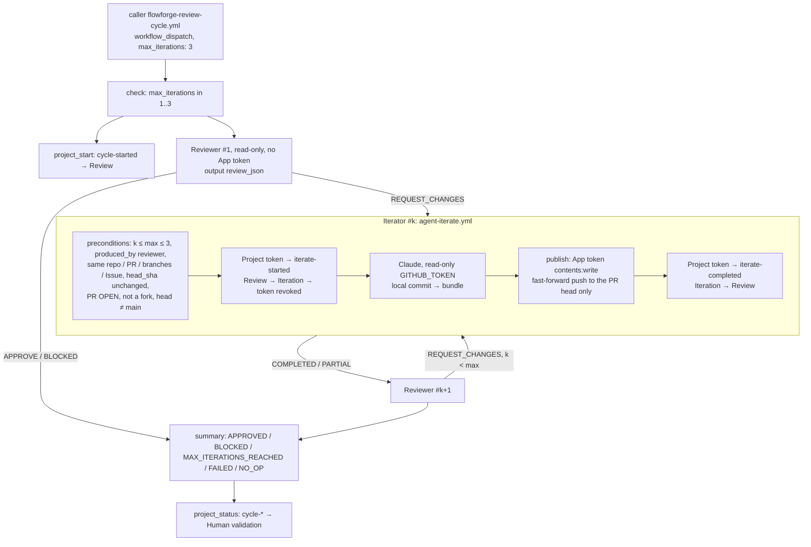
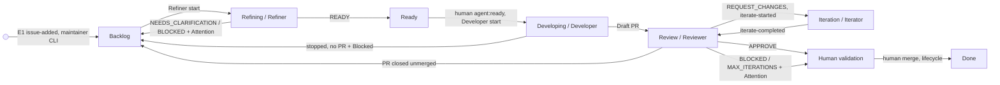

# 🗂️ Milestone — Phase 6: GitHub Project sync validated end to end

> **Date**: 2026-10-12 (UTC)
> **Status**: ✅ **Validated** (Prompt 29). We ran one real need through the whole chain, from raw Issue to
> Refiner `NEEDS_CLARIFICATION` → answer → `READY` → Developer → Draft PR → review cycle `APPROVE` →
> human merge. The card in [`FlowForge Development` #1](https://github.com/orgs/TiPunchLabs/projects/1)
> followed every real event, one item for the whole run, with no manual move of the card. The
> Iterator was **not needed**: the first review returned `APPROVE`. `Iteration` was therefore **not observed live** (§10).
> Two sync incidents occurred, both on the maintainer CLI and neither in Actions, plus one reservation (follow-up #44, identified during Prompt 29, **resolved in Prompt 29.3**, §18), see §8.
>
> **Prompt 29.1** (§16): two more legitimate needs, both `APPROVE` on first review; `Iteration` not observed.
>
> **Prompt 29.2** (§17): ✅ `Review → Iteration → Review` **observed live** on `demo-api` #45 / PR #46: real
> Reviewer `REQUEST_CHANGES` on a human-written PR with a real defect → Iterator `COMPLETED` (App push) →
> Reviewer `APPROVE` → `Human validation`. The loop bound and the entry contract are covered by `tests/iterate-preconditions.sh`.
>
> **Prompt 29.3** (§18): #44 resolved, Project Sync failures keep GitHub's reason, sanitized.
>
> **Phase 6 closed** (Prompt 30, 2026-10-12): **validated with reservations** (none blocking),
> frozen as tag `flowforge-phase6-github-projects-e2e` in FlowForge and `demo-api`. Closure audit,
> transition matrix, classified limitations and Git references in §19.
>
> **Prerequisites**: [kanban-model.md](../github-projects/kanban-model.md),
> [synchronization.md](../github-projects/synchronization.md),
> [phase5-refiner-e2e.md](phase5-refiner-e2e.md).

------

## 🧠 Mental Model

```text
  raw need                       demo-api Issue #39               card PVTI_lADODh96YM4BmneSzhAO11U
     │  sync-issue.sh issue-added (maintainer, E1)               (none) → Backlog            16:42:15
     │  Refiner #1   run 38279267264                             Backlog → Refining          16:42:40
     │               NEEDS_CLARIFICATION                         Refining → Backlog + ⚠️NC   16:43:44
     │  requester answers (comment)
     │  Refiner #2   run 38279498287                             Backlog → Refining (⚠️ cleared) 16:44:40
     │               READY                                       Refining → Ready            16:45:44
     │  human: agent:ready
     │  Developer    run 38279707776                             Ready → Developing          16:46:25
     │               Draft PR #40 (FlowForge App)                Developing → Review         16:47:30
     │  review cycle run 38279899674   cycle started            Review (unchanged)          16:48:11
     │               Reviewer #1 APPROVE                         Review → Human validation   16:49:15
     │  human: ready for review, approve, merge (fb0047b)
     ▼  lifecycle    run 38285653378                             Human validation → Done     17:39:35

  FlowForge workflows ──► Project        (each arrow above = one sync line in the run's log)
  Project ──► nothing                    (card move test §7: no run started)
```

------

## 1. 🎯 Objective

Prove on a real agent cycle what Prompt 28 could only check statically and with the
maintainer CLI. First, that every hook point writes the expected transition through the
**FlowForge App token** in Actions. Second, that the card shows where the need actually is.
And finally, that the Project never drives the agents.

------

## 2. 🏗️ Environment and pre-flight audit

All checks were done on 2026-10-12 before the test. FlowForge `main` was at `60bd4de` (PR #43 merged). Every
reusable workflow in the run logs resolves `agent-*.yml@refs/heads/main (60bd4deb…)`.

| Check | Result |
|---|---|
| Prompt 28 merged, `pre-commit run --all-files` | 18/18 hooks pass (`tests/project-sync.sh` included) |
| Project vs model (`bootstrap.sh --check`) | *Project conforms to the model*: 8 statuses, `Attention`, `Priority`, IDs = `config/github-project.json` |
| Callers in `demo-api` | sync enabled since `demo-api` #38 (`project_number: ${{ fromJSON(vars.FLOWFORGE_PROJECT_NUMBER \|\| '0') }}` in the 4 callers); the diff from `examples/` is only comments and target-specific tools |
| `FLOWFORGE_PROJECT_NUMBER` visible to `demo-api` | `1` (`repos/…/actions/organization-variables`) |
| Credentials visible to `demo-api` | `CLAUDE_CODE_OAUTH_TOKEN` (org), `FLOWFORGE_APP_CLIENT_ID` (var), `FLOWFORGE_APP_PRIVATE_KEY` (secret) |
| FlowForge App installation | `contents: write`, `metadata: read`, `organization_projects: write`, `pull_requests: write` (no `issues`) |
| `demo-api` | `main` clean at `4e69cf6`, no open PR |
| Items not to disturb | `demo-api` #30 (Backlog + Needs clarification), #31 (Ready), #33 (Done), `flowforge` #34 (Backlog): untouched at the end |

------

## 3. 📝 Scenario: raw need

We wanted a need that does not overlap the existing `/version`, `/info` and `/tasks/stats` or the open #30 and #31. It also had to be
deliberately loose so the Refiner had something to decide. That is why we did not use `/build-info`: it is
already covered by `/version` and `/info`.

**Issue** [`TiPunchLabs/demo-api#39`](https://github.com/TiPunchLabs/demo-api/issues/39), created
by `xgueret` on 2026-10-12T16:39:18Z, no label:

> *Task list should tell how many tasks there are* — "When a client lists tasks, it has no direct
> way to know the total number of tasks without counting the returned list itself. It would be nice
> if the task list response told how many tasks exist in total, for example through an
> `X-Total-Count` header, so a front end can display it."

**Not on the board after creation**, as expected: Issues are not auto-added (decision of
2026-10-12, synchronization §2). It entered the Project through E1,
`scripts/github-projects/sync-issue.sh TiPunchLabs/demo-api 39 issue-added`, which created the item
`PVTI_lADODh96YM4BmneSzhAO11U` directly in `Backlog` (16:42:15). The first attempt failed (incident 1, §8).

------

## 4. 🧭 Refiner

| | Refiner #1 | Refiner #2 |
|---|---|---|
| Run | [38279267264](https://github.com/TiPunchLabs/demo-api/actions/runs/38279267264) (dispatch 16:42:23) | [38279498287](https://github.com/TiPunchLabs/demo-api/actions/runs/38279498287) (dispatch 16:44:25) |
| Start sync (`refine` job) | 16:42:40 `Backlog → Refining` | 16:44:40 `Backlog → Refining`, `Attention Needs clarification → (none)` (B3) |
| Verdict | `NEEDS_CLARIFICATION`: 2 blocking questions (what "total" counts with filters and pagination; is `X-Total-Count` required), 1 non-blocking (CORS) | `READY` |
| Result sync (`publish` job) | 16:43:44 `Refining → Backlog`, `Attention → Needs clarification` (E4) | 16:45:44 `Refining → Ready` (E3) |
| Label | `agent:needs-clarification` (16:43:35) | removed (16:45:39) |

The clarification was **legitimate**: the raw text did not say whether filters count toward the
total, and that changes the tested value. The answer was posted as the requester
([comment](https://github.com/TiPunchLabs/demo-api/issues/39#issuecomment-6128590519), 16:44:22):
*"total" means tasks matching the filters, before `limit`/`offset`; the name is exactly `X-Total-Count`; the body is unchanged;
CORS is out of scope.* This only answers the questions. The need itself was not edited, and `READY` was not forced.
The refined Issue has 9 acceptance criteria, each with a provenance tag (`[provided]` / `[recommended]` / `[observed]`).

------

## 5. 🛠️ Developer

| Item | Value |
|---|---|
| Trigger | `agent:ready` applied by `xgueret` at 16:46:08 (human go) |
| Run | [38279707776](https://github.com/TiPunchLabs/demo-api/actions/runs/38279707776), job 114913712754, 16:46:14 → 16:47:34 |
| Start sync | 16:46:25 `Ready → Developing` (E7); card read `Developing` + `agent:running` while Claude ran |
| Step order (job) | 4 *Create Project token* → 5 *Project status (Developer started)* → 6 *Revoke Project token* → 7 checkout … 11 *Run Claude Code* → 13 *Create App delivery token* → 14 *Push branch and open Draft PR* → 16 *Create Project token (result)* → 17 *Project status (Developer result)* |
| Branch | `agent/39-feat-expose-total-task-count-in-x-total` |
| Commit | `2f8649e7df59b8aaf641748d99e97a20000ef34f` (README, `routes/tasks.py`, `tests/test_tasks.py`) |
| Draft PR | [#40](https://github.com/TiPunchLabs/demo-api/pull/40), author `app/tipunchlabs-flowforge`, 16:47:22 |
| Result sync | 16:47:30 `Developing → Review` (E8); label `agent:running → agent:review` (16:47:26) |
| PR CI | `Tests, lint and format` pass (run 38279845737, no approval needed: App author) |

------

## 6. 🔍 Review cycle

| Item | Value |
|---|---|
| Run | [38279899674](https://github.com/TiPunchLabs/demo-api/actions/runs/38279899674) (dispatch 16:47:55 for PR #40) |
| `project_start` job | 16:48:11 `Review → Review`: **unchanged** (E11 from its own target: no write) |
| Reviewer #1 | verdict **`APPROVE`**, *No findings* (PR comment `<!-- flowforge-review -->` by `github-actions[bot]`, 16:48:56) |
| Iterator #1–#3, Reviewer #2–#4 | skipped (`if:` gates): **no `Iteration` in this run** |
| `project_status` job | 16:49:15 `Review → Human validation` (E14), `Attention` empty |
| Agent work after that | none: no merge, PR still Draft, label `agent:review` (as designed until the merge, architecture §2.6) |

At 17:37:42 the human marked the PR ready. That started the stand-alone `flowforge-review.yml` (run 38285467658, success),
which is expected per the caller's comment. The card did not move: `agent-review.yml` has no sync (model §3).

------

## 7. 👤 Human validation, merge, Done

| Item | Value |
|---|---|
| Human actions | *Ready for review*, review **APPROVED** by `xgueret`, merge |
| Merge | 2026-10-12T17:39:20Z by `xgueret`, merge commit `fb0047b397c78e55b7d71af5425a3b5b9bd9d19f` |
| Merge gate | ruleset `flowforge-default-branch` (PR + 1 approval). An approval by a human, distinct from the App author, was observed. |
| Issue | closed `completed` at 17:39:21 (`Closes #39`) |
| Lifecycle | run [38285653378](https://github.com/TiPunchLabs/demo-api/actions/runs/38285653378): `agent:review → agent:done` (17:39:30–31) |
| Project | 17:39:35 `Human validation → Done` (E19), Attention empty |
| Items for `demo-api#39` | **1** at the end |

### 7.1 Card move does not trigger anything (step 25)

The card of `flowforge#34` is not part of the scenario. It was moved by `xgueret`'s `gh`, using the same
mutation the UI uses (`updateProjectV2ItemFieldValue`):
`Backlog → Ready` at 16:52:40, left there for 76 s, then `Ready → Backlog` at 16:53:56. **No run** was
created in `demo-api` or `flowforge` after 16:52:38 (listed after 60 s). Statically, the `on:` blocks of
FlowForge are `workflow_call` (+ `pull_request`/`push` for its own `ci.yml`). The `demo-api` callers use
`issues`, `pull_request` and `workflow_dispatch`. No workflow uses `projects_v2*` or `project*`.

------

## 8. ⚠️ Incidents

| # | Symptom | Cause | Impact | Correction | After |
|---|---|---|---|---|---|
| 1 | `sync-issue.sh … 39 issue-added` → `::warning:: … failed: could not add or read the Project item` (16:39:24) | maintainer `gh` login had `read:project` only; `addProjectV2ItemById` needs `project` (raw GraphQL: `INSUFFICIENT_SCOPES`) | CLI only; no workflow involved | `gh auth refresh -h github.com -s project`. The maintainer **keeps** `project` from now on (no more add/remove between Prompts). | retry 16:42:15: `update — (none) → Backlog` |
| 2 | First replay of `cycle-approved` (CLI, 16:50:01) → same warning | **unknown**: not reproducible (3 retries `unchanged`; raw `addProjectV2ItemById` returned the item) | CLI only; card unchanged, nothing lost | none needed | replays OK |
| R | Both warnings hide GitHub's reason: `flowforge_project_sync` keeps `tail -n 1` of stderr, i.e. the helper's own message | design gap in error reporting | a missing App permission in Actions would be equally opaque | **follow-up [#44](https://github.com/TiPunchLabs/flowforge/issues/44)** (not needed for this E2E) | **RESOLVED** in Prompt 29.3 (§18) |

**No sync failed in Actions**: all 9 workflow sync lines are `update` or `unchanged`. There are no
`##[warning]` or `##[error]` lines in the 19 job logs read.

------

## 9. ♻️ Idempotence and regression guard (live, on card `demo-api#39`)

All of these were run with `sync-issue.sh` (same helper, strict mode) while the card was in `Human validation`:

| Event replayed | Expected | Observed | Verdict |
|---|---|---|---|
| `cycle-started` by the workflow (card already `Review`) | unchanged | `unchanged`, no write (16:48:11) | PASS |
| `cycle-approved` × 3 (16:50) | unchanged | `unchanged` × 3, after incident 2 | PASS |
| `issue-added` (Backlog) | refused (behind) | `refused … stale event: card already in Human validation, ahead of Backlog` | PASS |
| `refine-ready` (`Human validation → Ready`) | refused | `refused … ahead of Ready`, card untouched | PASS |
| `develop-started` (`→ Developing`) | refused | `refused … ahead of Developing`, card untouched | PASS |
| Item count after all replays | 1 | 1 (`gh project item-list`) | PASS |

------

## 10. 🗺️ Run actually executed

```mermaid
flowchart LR
    N[(none)] -->|issue-added, CLI| A[Backlog]
    A -->|Refiner #1 start| B[Refining]
    B -->|NEEDS_CLARIFICATION| A2[Backlog + Needs clarification]
    A2 -->|answer, Refiner #2 start| B2[Refining]
    B2 -->|READY| C[Ready]
    C -->|human agent:ready, Developer start| D[Developing]
    D -->|Draft PR #40| E[Review]
    E -->|Reviewer #1 APPROVE| G[Human validation]
    G -->|human merge fb0047b| H[Done]
```



`Iteration` was **not** reached: the first review returned `APPROVE`. The two Iterator transitions
(`iterate-started` E12, `iterate-completed` E13) were checked earlier only on the real Project with the
maintainer CLI (synchronization §9.1, steps 10–11) and by tests C/D. **Their App-token path in Actions
is not yet observed live.**

------

## 11. 📊 Evidence

| Step | Project status | Event | Run / reference | Verdict |
|---|---|---|---|---|
| Creation | — (not on board) | Issue #39 created 16:39:18 | [#39](https://github.com/TiPunchLabs/demo-api/issues/39) | PASS (by design) |
| Entry | Backlog | E1 `issue-added` (CLI) 16:42:15 | item `PVTI_lADODh96YM4BmneSzhAO11U` | PASS (after incident 1) |
| Refiner #1 start | Refining | E2 16:42:40 | 38279267264 / job 114912274212 | PASS |
| Refiner #1 result | Backlog + Needs clarification | E4 16:43:44 | job 114912649344 | PASS |
| Refiner #2 start | Refining | E2 (B3) 16:44:40 | 38279498287 / job 114913036393 | PASS |
| Refiner READY | Ready | E3 16:45:44 | job 114913430136 | PASS |
| Developer start | Developing | E7 16:46:25 | 38279707776 / job 114913712754 | PASS |
| Draft PR | Review | E8 16:47:30 | PR #40, `2f8649e` | PASS |
| Cycle start | Review (unchanged) | E11 16:48:11 | 38279899674 / job 114914416280 | PASS |
| Reviewer | Human validation | E14 16:49:15 (`APPROVE`) | job 114914816487 | PASS |
| Iterator | — | not needed | — | N/A |
| Merge | Done | E19 17:39:35 | 38285653378, `fb0047b` | PASS |

### 11.1 Labels vs Project

| Time | Label | Card | Consistent |
|---|---|---|---|
| 16:43:35–16:45:39 | `agent:needs-clarification` | Backlog + Needs clarification | yes |
| 16:46:08 | `agent:ready` (human) | Ready | yes |
| 16:46:21 | `agent:running` | Developing (16:46:25) | yes |
| 16:47:26 | `agent:review` | Review (16:47:30) → Human validation (16:49:15) | yes: `agent:review` covers both until the merge (§2.6); the card is more precise |
| 17:39:31 | `agent:done` | Done (17:39:35) | yes |

Final state: Issue closed, `agent:done` only, card `Done`, no `Attention`, no agent label left.

------

## 12. 🔐 Security and permissions

**`GITHUB_TOKEN` per job** (from the *GITHUB_TOKEN Permissions* group in each log):

| Job | `GITHUB_TOKEN` | App token(s) minted |
|---|---|---|
| Refiner `refine` (agent) | contents, issues, pull-requests: read | Project only (start), revoked before checkout/Claude |
| Refiner `publish` | issues: write | Project only (result) |
| Developer `develop` | contents, issues, pull-requests: write (unchanged since Phase 4.1) | Project (start, revoked before Claude) · delivery `contents` + `pull-requests: write` (#34, after Claude) · Project (result) |
| Cycle `project_start` / `project_status` | issues, pull-requests: read | Project only |
| Reviewer `Review PR` | read only (checks, contents, issues, PRs, statuses) | **none** |
| Reviewer `Publish review on PR` | pull-requests: write | none |
| Lifecycle `terminal_state` | issues: write, pull-requests: read | Project only |

| Control | Result |
|---|---|
| Project tokens request only `permission-organization-projects: write` (every Project token step in the logs) | PASS |
| Project start token revoked **before** Claude (`Token revoked` in refine ×2, develop, cycle start, lifecycle) | PASS |
| Reviewer receives no App key / token | PASS |
| Sync adds no code permission to `GITHUB_TOKEN` | PASS |
| No token in logs (`ghs_`, `ghp_`, `gho_`, `github_pat_`, `sk-ant-`, private key: 0 matches in 19 job logs) | PASS |
| No token in code / comments (pre-commit `detect private key`; no secret in diff of PR #40 or in Issue/PR comments) | PASS |
| `CLAUDE_CODE_OAUTH_TOKEN` used only by agent steps | PASS (static, unchanged) |
| No `secrets: inherit` in `demo-api` callers | PASS |
| Multi-repository resolution: Issue read as `repos/$GITHUB_REPOSITORY/issues/<n>` → node id; PR numbers refused; test B *same number in another repository: untouched* | PASS (static + unit test; the board holds `demo-api` and `flowforge` items) |
| Agents independent of the Project: `project_number` defaults to `0`, every Project step `continue-on-error: true` (tests D) | PASS (static) |

------

## 13. 👤 Human interventions

| Action | By | Kind |
|---|---|---|
| Issue #39 created (raw need) | Claude Code, `xgueret` account | administrative (test setup) |
| `issue-added` via CLI | Claude Code, `xgueret` account | administrative (E1 is manual by design) |
| `gh auth refresh -s project` | `xgueret` | environment fix |
| 2 × Refiner dispatch, review cycle dispatch | Claude Code, `xgueret` account (go-ahead given) | administrative trigger |
| Answer to the Refiner's questions | Claude Code as requester | **functional input** (answers only, need not edited) |
| `agent:ready` | Claude Code, `xgueret` account (go-ahead given) | human go |
| Ready for review, approval, merge PR #40 | `xgueret` | human gate |
| Card move `flowforge#34` and back; idempotence/regression replays | Claude Code, `xgueret` account | test, outside the main flow |

No manual move of the scenario's card. No change to code, the model or the workflows during the test.

------

## 14. ⚠️ Limitations and reservations

- ~~`Iteration` not observed live~~: observed in Prompt 29.2 (§17), on a human-written PR (no Developer in that run).
- **E1 is manual**: an Issue enters the board at its first FlowForge event or through `sync-issue.sh`.
  Closing or reopening (E21/E22) does not move a card.
- ~~**Sync diagnostics truncated**~~ (#44): identified during Prompt 29, **RESOLVED** in Prompt 29.3 (§18).
- **Incident 2 unexplained** (one-off, CLI only).
- **No reconciliation job**: a run that dies before its sync step leaves a stale card (model §8).
- **The Project never triggers agents**, by design. Card moves are visual only.
- **Notion is not integrated.**

------

## 15. ✅ Acceptance criteria (Prompt 29)

| Criterion | Result |
|---|---|
| A real E2E Issue was used | PASS (#39) |
| The Issue appears in the Project | PASS |
| Initial status correct | PASS (Backlog via E1, the mechanism of Prompt 28) |
| Refiner → `Backlog → Refining` | PASS (×2) |
| Refiner READY → `Refining → Ready` | PASS |
| Developer → `Ready → Developing` | PASS |
| A real Draft PR is created | PASS (#40) |
| Draft PR → `Developing → Review` | PASS |
| Reviewer actually executed | PASS |
| `REQUEST_CHANGES` → `Review → Iteration` | NOT VERIFIED in Prompt 29 (did not occur) → **PASS in Prompt 29.2** (§17) |
| Iterator → `Iteration → Review` | NOT VERIFIED in Prompt 29 (did not occur) → **PASS in Prompt 29.2** (§17) |
| `APPROVE` → `Review → Human validation` | PASS |
| No automatic merge | PASS |
| Final merge is human | PASS (`xgueret`) |
| `Human validation → Done` | PASS |
| All transitions traceable | PASS (§11) |
| No duplicate Project item | PASS (1) |
| Idempotence tested | PASS (§9) |
| Invalid status regression blocked or reported | PASS (§9) |
| Project Sync errors visible | PASS, with reservation #44 (reason truncated) → reservation **RESOLVED** in Prompt 29.3 (§18) |
| No secret exposed | PASS |
| Permissions least privilege | PASS |
| Labels consistent enough | PASS (§11.1) |
| The Project triggers no agent | PASS (§7.1) |
| Agents usable independently of the Project | PASS (static) |
| Multi-repository resolution safe | PASS (static + unit test) |
| E2E documentation exists | PASS (this document) |
| Notion not introduced | PASS |

The two Iterator criteria stayed `NOT VERIFIED` after Prompt 29.1 (§16) and passed live in Prompt 29.2 (§17).

**Next**: Prompt 30 — official closure of Phase 6.

------

## 16. 🔁 Iterator live validation (Prompt 29.1)

> **Status**: ⚠️ **Partially validated**. Two new, legitimate needs ran through the real chain with
> the real Reviewer. **Both got `APPROVE` on the first review**, so the path
> `REQUEST_CHANGES → Iteration → Iterator → Review` was **still not observed live**. The test
> stopped after round 2 (user decision): the Reviewer was never forced, and no PR was degraded on purpose.

### 16.1 Pre-flight audit (2026-10-12, ~19:05 UTC)

| Check | Result |
|---|---|
| FlowForge `main` | `60bd4de`; the Prompt 29 docs were still uncommitted on `docs/phase6-github-projects-e2e` |
| Chain | caller `flowforge-review-cycle.yml` (`workflow_dispatch`, `max_iterations: 3`) → `review-cycle.yml`: Reviewer #1 → Iterator #1 → … → Reviewer #4, `if:` gates |
| `Review → Iteration` | written by `iterate-started` (E12) in the Iterator's `iterate` job, **not** by the Reviewer job (synchronization §3) |
| `Iteration → Review` | `iterate-completed` (E13) in the `publish` job, after the fast-forward push |
| Iterator App tokens | `iterate`: Project token only, revoked before checkout and Claude. `publish`: delivery token `contents: write` (push), then Project token (result) |
| Project | `bootstrap.sh --check`: conforms. Items #30, #31, `flowforge#34` not touched |
| `demo-api` | `main` `fb0047b`, no open PR |

### 16.2 Round 1: optional `due_date`, through the Refiner

| Step | Reference | Card `PVTI_lADODh96YM4BmneSzhAQliE` |
|---|---|---|
| Issue [#41](https://github.com/TiPunchLabs/demo-api/issues/41), raw need, 19:11:45 | E1 via `sync-issue.sh` | (none) → Backlog (19:11:51) |
| Refiner #1, run [38296033728](https://github.com/TiPunchLabs/demo-api/actions/runs/38296033728) | `NEEDS_CLARIFICATION`: 3 blocking questions (removal mechanism, `PUT` without the field, duplicate) | Backlog → Refining (19:12:12) → Backlog + Needs clarification (19:13:19) |
| Requester [answer](https://github.com/TiPunchLabs/demo-api/issues/41#issuecomment-6130916531) | `PATCH null` clears, `PUT` clears, duplicate copies | — |
| Refiner #2, run [38296238995](https://github.com/TiPunchLabs/demo-api/actions/runs/38296238995) | `READY` | Backlog → Refining (19:14:01) → Ready (19:15:01) |
| `agent:ready` (19:15:27), Developer run [38296437260](https://github.com/TiPunchLabs/demo-api/actions/runs/38296437260) | Draft PR [#42](https://github.com/TiPunchLabs/demo-api/pull/42) `bf94441`, author `app/tipunchlabs-flowforge`, CI pass | Ready → Developing (19:15:44) → Review (19:17:37) |
| Review cycle, run [38296751414](https://github.com/TiPunchLabs/demo-api/actions/runs/38296751414) | Reviewer #1 **`APPROVE`**, 15/15 criteria, no findings. Iterators #1–#3 skipped | Review unchanged (19:18:31) → Human validation (19:19:39) |
| Human merge (`xgueret`) 19:48:33, `b5f9a1e` | lifecycle run 38300089233: `agent:done` | Human validation → Done |

The need held real traps of the repository: `toggle_task` and `duplicate_task` rebuild a
`TaskIn` by hand, and `TaskPatch` rejects every `null`. **The Refiner found them itself** and listed
them in *Notes for agents*. The Developer then handled each one, with one test per operation.

### 16.3 Round 2: sorting `GET /tasks`, human-written Issue (no Refiner)

The Refiner is optional: an executable Issue comes from "the Refiner or a human"
(issue contract), and `develop-started` accepts a card in `Backlog`. The Issue was written as a
precise human specification (9 criteria) **without implementation hints**. That way the Refiner could not
point the Developer at the traps: severity order of `priority`, case-insensitive `title`, ties by id ascending in
**descending** sorts, `sort=` → 422, interaction with filters, pagination and `X-Total-Count`.

| Step | Reference | Card `PVTI_lADODh96YM4BmneSzhARBFk` |
|---|---|---|
| Issue [#43](https://github.com/TiPunchLabs/demo-api/issues/43), 19:49:00 | E1 via `sync-issue.sh` | (none) → Backlog (19:49:08) |
| `agent:ready` (19:49:10), Developer run [38300154884](https://github.com/TiPunchLabs/demo-api/actions/runs/38300154884) | Draft PR [#44](https://github.com/TiPunchLabs/demo-api/pull/44) `18e69b0`, App author, CI pass | Backlog → Developing (19:49:27, allowed source) → Review (19:51:13) |
| Review cycle, run [38300443112](https://github.com/TiPunchLabs/demo-api/actions/runs/38300443112) | Reviewer #1 **`APPROVE`**, no findings. Iterators skipped | Review unchanged (19:52:02) → Human validation (19:53:10) |

Human merge (`xgueret`) 19:56:05, `1b0dab5`. Lifecycle run 38300917278 set `agent:done` and moved the card
`Human validation → Done`.

The verdict was checked independently: a stable `list.sort(key=…, reverse=True)` keeps ties in ascending id
order, so the `APPROVE` is justified. The Reviewer did not miss a defect.

### 16.4 What was verified, what was not

| Prompt 29.1 criterion | Result |
|---|---|
| New dedicated test Issue | PASS (#41, #43) |
| Developer created a real PR | PASS (#42, #44) |
| Reviewer produced `REQUEST_CHANGES` with a real finding | **NOT VERIFIED** (2 × `APPROVE`, justified) |
| `Review → Iteration`, Iterator run, Iterator commit, `Iteration → Review`, second review | **NOT VERIFIED** (not reached) |
| Iterator App token (delivery + Project) in Actions | **NOT VERIFIED** (Iterator jobs skipped) |
| Iteration bound | PASS (static: caller `max_iterations: 3`, `check` job refuses > 3; Iterators #2–#3 gated) |
| One Project item per Issue, no duplicate | PASS (1 item each, live trace every 5 s) |
| Sync errors | PASS (16 sync lines in Actions, all `update` / `unchanged`, no `##[warning]`/`##[error]` in 18 job logs) |
| Idempotence | PASS for `cycle-started` (`unchanged` × 2, from the workflow). The CLI replays of the Iterator events were **not run** (local permission refusal on a shared resource); see §9 for Prompt 29 |
| Regression guard | NOT RE-TESTED here (covered live in §9) |
| Labels | PASS: `agent:needs-clarification` → none → `agent:ready` → `agent:running` → `agent:review` → `agent:done`, one state label at a time |
| No secret in logs (`ghs_`, `ghp_`, `gho_`, `github_pat_`, `sk-ant-`, private key) | PASS (0 matches, 18 job logs) |
| Project start tokens revoked before Claude | PASS (`Token revoked` in every refine, develop and cycle start job) |
| No push to `main`, no force push | PASS (PRs from `agent/*` branches, App author; merges by `xgueret`) |
| Reviewer read-only | PASS (no App token in `Review PR`) |

### 16.5 Finding: the Iterator is rarely reached

Of the documented first reviews of Developer PRs on `demo-api` (#7, #12, #14, #16, #18, #20, #34, #40,
#42, #44), **9 of 10** returned `APPROVE`. The only
`REQUEST_CHANGES` (PR #20, Phase 4) came from a conflict between the Issue and the repository's documentation
conventions, not from a code defect. With precise needs, and more so after the Refiner, the
Developer delivers code that is correct on the first pass. This is good for FlowForge, but it means a live `Iteration` cannot
be obtained on demand without breaking the rule "never force the Reviewer".

Options for a later prompt (not decided here): a larger need, such as conditional requests
(`ETag` / `If-None-Match`, RFC 9110), or accept the Phase 4 live evidence (Iterator on PR #20, before the
Project sync existed) together with the CLI run of E12/E13 (synchronization §9.1) as sufficient.

### 16.6 Requalification

```text
Iterator criterion 1 (REQUEST_CHANGES → Review → Iteration): NOT VERIFIED
Iterator criterion 2 (Iterator → Iteration → Review):        NOT VERIFIED
```

Superseded by Prompt 29.2 (§17), which observed both live.

------

## 17. 🔁 Iterator cycle, controlled validation (Prompt 29.2)

> **Status**: ✅ **Validated**, with the reservations of §17.7. Two complementary scenarios:
> **A** an offline contract test of the real step scripts, and **B** a live run in which the **real**
> Reviewer found a **real** defect in a human-written PR, the Iterator fixed it, and the Reviewer approved.
> The Reviewer was never told about the defect and never forced. Its prompt and inputs are unchanged.

### 17.1 Audit: why there is no live injection

`agent-iterate.yml` receives the review as the `review_json` input and accepts it only if
`produced_by == "reviewer"` and repository, PR, branches, Issue and `head_sha` match the live PR.
A live "injected" `REQUEST_CHANGES` would therefore need either a hand-written Reviewer result (a
fake Reviewer identity) or a test bypass in the production workflow. Both were ruled out.
Scenario A tests the same contract offline, and scenario B produces a genuine verdict.



### 17.2 Scenario A: contract test `tests/iterate-preconditions.sh` (simulated, not E2E)

It is a new pre-commit hook that runs the **real** `iterate/Check preconditions`, `check/Validate inputs` and
`summary/Compute cycle result` scripts (extracted with `yq`, `gh` stub) and the real
`flowforge-project.sh` decisions. 86 checks:

| Group | What it proves |
|---|---|
| A | a valid `REQUEST_CHANGES` passes; work list = findings + one MAJOR per FAIL criterion; 3/3 allowed |
| B | 4/3, 2/1, max 4, max 0, iteration 0, non-integer → refused **before any GitHub call** |
| C | `APPROVE` / `BLOCKED`, `produced_by` ≠ reviewer, other schema / repository / PR / branch / Issue, older head, malformed findings, empty work list, non-JSON → refused |
| D | head branch `main`, zero or two linked Issues → refused |
| E | cycle `max_iterations` ∉ 1..3 refused; `iterate_k` gates and inputs; no `iterate_4`; 3 × `REQUEST_CHANGES` → `MAX_ITERATIONS_REACHED` (3 used); max 1 → stops after 1; `REQUEST_CHANGES → COMPLETED → APPROVE` → `APPROVED`; Iterator failure → `FAILED` |
| F | card loop `Review → Iteration → Review` × 3, then `Human validation + Max iterations`; duplicate `iterate-started` / `iterate-completed` → `unchanged`; late `develop-delivered`, `refine-ready`, `iterate-*` → `refused` |

A mutation check (ceiling 4, bound +1, `produced_by` check removed, cycle `^[1-4]$`) made 15
checks fail. Note: `cycle-approved` while the card is in `Iteration` is **applied** (Human validation is
ahead): this is the stale guard's designed catch-up of a missed event, not a regression.

### 17.3 Scenario B: real defect, real Reviewer, real Iterator

| Item | Reference |
|---|---|
| Issue | [demo-api#45](https://github.com/TiPunchLabs/demo-api/issues/45) `GET /tasks/due?before=…`, 9 explicit criteria, edge case: a task due **on** `before` is not returned. Created 20:56:37 |
| Card | `PVTI_lADODh96YM4BmneSzhARulg`, E1 via CLI 20:57:36 → Backlog |
| PR | [#46](https://github.com/TiPunchLabs/demo-api/pull/46), Draft, author `xgueret` (human, **no Developer run**), branch `e2e/45-tasks-due` (not `agent/*`), commit `f82149a` |
| Defect | `task.due_date <= before` instead of `<`, no boundary test. Shown locally before the push (a task due 2026-02-01 is returned for `before=2026-02-01`). Tests (111) and lint pass, no existing behaviour changed, no security impact. PR body and commit message neutral |
| CI | `Tests, lint and format` pass (run 38307562701) |
| Cycle | run [38307610709](https://github.com/TiPunchLabs/demo-api/actions/runs/38307610709), dispatch 20:57:59, FlowForge `main` `60bd4de` |

| Job | Result |
|---|---|
| Reviewer #1 (115005388415) | **`REQUEST_CHANGES`** on `f82149a`: BLOCKER *Filter is inclusive (<=) instead of strictly before* (`routes/tasks.py:88`, fix `<`); MAJOR *Missing edge-case test*; criteria 1, 2 and 7 FAIL, the other 6 PASS |
| Iterator #1 `iterate` (115005667480) | preconditions OK (1/3), Project token → `iterate-started` → **revoked** (step 6) before checkout (7) and Claude (11) |
| Iterator #1 `publish` (115005969794) | App delivery token `permission-contents: write`; push `f82149a..c050851 → e2e/45-tasks-due` (fast-forward); Project token → `iterate-completed`; both tokens revoked in post steps |
| Iterator result | `COMPLETED`, 5 work items (2 findings + 3 FAIL criteria) all `FIXED`, `commit.pushed: true` |
| Reviewer #2 (115006100806) | **`APPROVE`** on `c050851`, 0 findings |
| Summary | `APPROVED`, `iterations_used: 1`; Iterators #2–#3 and Reviewers #3–#4 skipped |

**Iterator commit** `c0508510b95f14a5734eb1494f2fee4bb2b9f7b3`, *fix: make GET /tasks/due strictly before the
given date*: `routes/tasks.py` (`<=` → `<`, 1 line) and `tests/test_tasks.py` (+1 test
`test_due_excludes_task_due_on_the_given_date`: a task due 2026-01-31 is returned, one due 2026-02-01 is not). Nothing else
changed: exactly the two findings.

### 17.4 Project transitions (Actions sync lines + 5 s live trace)

| From | Event | To | Time (sync / trace) | Verdict |
|---|---|---|---|---|
| (none) | E1 `issue-added` (CLI) | Backlog | 20:57:36 | PASS |
| Backlog | `cycle-started` | Review | 20:58:13 / 20:58:19 | PASS: *unexpected source Backlog, applied* (no Developer in this scenario) |
| Review | `iterate-started` (Reviewer #1 `REQUEST_CHANGES`) | **Iteration** | 20:59:07 / 20:59:13 | **PASS** |
| Iteration | `iterate-completed` (push `c050851`) | **Review** | 21:00:07 / 21:00:12 | **PASS** (head changed at 21:00:06, card moved after) |
| Review | `cycle-approved` (Reviewer #2) | Human validation | 21:01:22 / 21:01:26 | PASS |

One item for #45 at the end, no `Attention`, 4 sync lines in Actions, all `update`, no `##[warning]` / `##[error]`.

**Live replays** (CLI, same helper, 21:02:36–42): `cycle-approved` × 2 → `unchanged`;
`iterate-started`, `iterate-completed`, `develop-delivered` → `refused` (*stale event: card already in Human
validation*). Card unchanged, still 1 item.

### 17.5 Security

| Control | Result |
|---|---|
| No secret in the 10 job logs (`ghs_`, `ghp_`, `gho_`, `github_pat_`, `sk-ant-`, private key) | PASS (0 matches; token env shown as `***`) |
| Iterator `iterate`: `GITHUB_TOKEN` contents / issues / pull-requests **read**; Project token `organization-projects: write` only, revoked before Claude | PASS |
| Iterator `publish`: `GITHUB_TOKEN` contents write (unused for the push); App token `contents: write` only; no Claude, no PR code run | PASS |
| Reviewer: `GITHUB_TOKEN` read-only (checks, contents, issues, PRs, statuses), no App token | PASS |
| Push only to the PR head, fast-forward (`f82149a..c050851`, no `+`) | PASS |
| `main` unchanged (`1b0dab5` before and after) | PASS |
| One PR for #45, no second PR | PASS |
| No merge by FlowForge; PR #46 still Draft | PASS |
| Reviewer prompt, inputs and workflows unchanged; no production workflow modified (only a new test file and hook) | PASS |

### 17.6 Labels

The Issue never had an `agent:*` label: no Developer run (only the Developer sets `agent:running` /
`agent:review`), and the cycle sets a label only on `BLOCKED` / `MAX_ITERATIONS_REACHED`. This is expected
for a human-written PR and is **not** a deviation of the label lifecycle.

### 17.7 Validated / simulated / not verified

| Behaviour | Status |
|---|---|
| Real Reviewer `REQUEST_CHANGES` on a real defect, findings exact and actionable | **validated live** |
| `Review → Iteration`, Iterator run, App-token push, `Iteration → Review`, second review `APPROVE`, `Human validation` | **validated live** |
| Duplicate / replayed / stale events on the card | **validated live** (CLI) + simulated (F) |
| `max_iterations = 3`, 4th iteration refused, `MAX_ITERATIONS_REACHED`, Iterator failure → `FAILED` | **simulated** (A, real scripts); not run live (no need for 3 real iterations) |
| Iterator `PARTIAL` / `BLOCKED` live | not verified live (covered by `iterator-partial-delivery.sh`) |
| Developer → Iterator on the same PR | not in this run (Developer and Iterator each validated live; Phase 4 showed the chain on PR #20, before the Project sync) |

Residual risks: the defect was planted by a human, so the run proves the loop mechanics and the
Reviewer's detection on an explicit criterion, not how often a Developer PR needs an iteration (§16.5).
PR #46 is human-authored: under the ruleset, merging it needs an approval from someone other than the author.
**Not merged**: closing it is the human's decision.

------

## 18. 🔎 Project Sync error observability (#44, Prompt 29.3)

> **Status**: ✅ **Resolved**. #44 was identified during Prompt 29 (§8, incidents 1–2, reservation R)
> and fixed here. The fix is verified by tests and live on the CLI, and it reaches the workflows with the PR that closes #44
> (the Issue stays open until then, with a [summary comment](https://github.com/TiPunchLabs/flowforge/issues/44#issuecomment-6133471510)). Only the failure message changed: the decision table, the transitions, the
> workflows, the agents and the permissions are untouched.

### 18.1 Reproduction before the fix (2026-10-12, real `gh`, harmless)

These are maintainer runs of the real helper (`flowforge_project_sync`) on card `demo-api#45`, with a **copy** of the IDs file
holding a bogus ID, so the failing GraphQL call cannot write anything. The card was checked unchanged afterwards.

| Case | Raw stderr of `_flowforge_project_sync` | Warning shown | Lost |
|---|---|---|---|
| bogus `project_id`, `cycle-approved` | `gh: Could not resolve to a node with the global id of 'PVT_kwDOinvalid000'` / `could not add or read the Project item` | `failed: could not add or read the Project item.` | GitHub's reason |
| bogus Attention field ID, `cycle-blocked` | `gh: Could not resolve to a node with the global id of 'PVTSSF_invalidField0'` / `could not set Attention to 'Blocked'` | `failed: could not set Attention to 'Blocked'.` | GitHub's reason |

**Root cause**: the wrapper built its message from `$(tail -n 1 "$err")`
(`.github/scripts/flowforge-project.sh`). Every failure path is `gh … || { echo "<helper message>" >&2;
return 1; }`: `gh` prints GitHub's reason first, the helper appends its own line, and only that
last line was kept. **Side finding**: when the Status write succeeded and the Attention write failed, the
message still said *The card is unchanged*.

### 18.2 Fix

- The helper tags its messages on stderr (`flowforge: <operation>`, `flowforge-partial: <write>`), and the
  wrapper separates them from the tool's output (`_flowforge_project_failure`).
- Format: `failed: <operation> — GitHub: <reason>. <card>; the agent run is not affected.`, with the
  transition in write operations (`could not set Status Review → Iteration`).
- `_flowforge_project_reason`: drops the `gh: ` prefix, turns GraphQL JSON `errors[]` into `TYPE: message`, skips blank lines,
  caps at 5 lines × 300 characters and 800 in total (`…`). With empty output, the fallback is `Unknown GitHub Project sync error`.
- `_flowforge_project_redact`: masks the exact token values, `gh*_` / `github_pat_` / `sk-ant-` / JWT / `Authorization` /
  `Bearer` / `token=` / private keys, before the limits apply. GitHub Actions masking stays on as a second layer.
- Unchanged: warning + exit 0 in workflows, exit 1 in strict mode, and the exact text of `update` /
  `unchanged` / `refused` / `skipped`.
- Details: synchronization §6.1.

### 18.3 After the fix (same live cases)

```text
… [cycle-approved] failed: could not add or read the Project item — GitHub: Could not resolve to a node with the global id of 'PVT_kwDOinvalid000'. The card is unchanged; the agent run is not affected.
… [cycle-blocked] failed: could not set Attention (none) → Blocked — GitHub: Could not resolve to a node with the global id of 'PVTSSF_invalidField0'. The card is unchanged; the agent run is not affected.
```

Exit 0 (non-strict), exit 1 (strict). The real token occurs **0** times in the output and the summary file.
Card `demo-api#45` is unchanged (`Human validation`); a normal replay still gives `unchanged`.

### 18.4 Tests

`tests/project-sync.sh` group **E** (20 checks, real wrapper and helper, `gh` stub). The regression check
*"#44 regression: GitHub's reason kept, not only the helper's last line"* failed before the fix and passes after.

| Test | Result |
|---|---|
| single-line error (#44 regression) | PASS |
| multi-line error, kept in order | PASS |
| sanitization (exact value, `ghs_`, `github_pat_`, `sk-ant-`, JWT, `Authorization: Bearer`, `token=`) | PASS |
| `gh` silent → operation only; nothing → fallback | PASS |
| GraphQL JSON `errors[]` | PASS |
| size limits | PASS |
| Status transition named; partial update reported | PASS |
| strict mode exit 1 | PASS |
| `update` / `unchanged` / `refused` text and exit code | PASS |

All 173 checks of `tests/project-sync.sh` pass. `pre-commit run --all-files`: all hooks pass.

### 18.5 What is not verified

- **Actions: NOT VERIFIED LIVE.** No failure was provoked in an Actions run: that would need a test
  workflow or a bogus production IDs file, which are out of scope. The workflows fetch and source the same helper
  file at their pinned commit (tests C/D), so the Actions path runs the same code as the live CLI check.
- `INSUFFICIENT_SCOPES` (incident 1) was not reproduced live: it would need a degraded login. It is covered by
  the GraphQL JSON test and by the `gh` line format observed live.
- Incident 2 (one-off, unexplained) cannot be explained after the fact, but the same symptom would now show its reason.

------

## 19. 🏁 Phase 6 closure (Prompt 30)

> **Result**: **validated with reservations**. Every Phase 6 deliverable is on `main`, every major
> Project transition was observed live, #44 is closed, and no reservation is blocking.
> Audit only: no new workflow, agent behaviour, status, state machine or integration.

Prompt numbering: the closure request calls the Iterator validation "29.1" and the #44 fix "29.2";
this document uses §17 = Prompt 29.2 (Iterator) and §18 = Prompt 29.3 (#44). Same work.

### 19.1 🏗️ Architecture

```text
GitHub Issue ──► FlowForge agent workflow ──► Project Sync (flowforge-project.sh, App token) ──► GitHub Project
                 (Refiner, Developer, review cycle, Iterator, lifecycle)                            (visual only)

GitHub Project ──► nothing        (no projects_v2 trigger; card moves start no run, §7.1)
```



The diagram is the implemented decision table (synchronization §3), not an aspiration. Technical
failures (`*-failed`) keep the status and set `Attention = Failed`; `NO_OP` writes nothing. Only
`Backlog → Developing` (a human-written `agent:ready` Issue, no Refiner) and `Backlog → Review`
(a human PR sent to the review cycle) are additional live paths, both allowed by the stale guard.

### 19.2 📦 Deliverables on `main` (audited at `73a71d3`, PR #45 merged 2026-10-12T23:31:29Z)

| Prompt | Deliverable | Where | Audit |
|---|---|---|---|
| 26 | Kanban model: 8 statuses, `Attention`, transitions, source of truth | `docs/github-projects/kanban-model.md` | ✅ present |
| 27 | Provisioning (idempotent, `--check`), IDs | `scripts/github-projects/bootstrap.sh`, `config/github-project.json`, `docs/github-projects/provisioning.md` | ✅ present |
| 28 | One-way sync + stale guard, maintainer CLI, callers opt-in | `.github/scripts/flowforge-project.sh`, `scripts/github-projects/sync-issue.sh`, 5 reusable workflows, `docs/github-projects/synchronization.md` | ✅ present |
| 28 | Project Sync tests | `tests/project-sync.sh` (pre-commit hook) | ✅ present, pass |
| 29.2 | Iterator entry contract / loop bound / card loop tests | `tests/iterate-preconditions.sh` (pre-commit hook) | ✅ present, pass |
| 29.3 | #44 fix + regression group E + synchronization §6.1 | commit `72e0f7d`, merge `73a71d3`, `Closes #44` | ✅ present, #44 closed 23:31:30Z |
| 29–29.3 | E2E evidence | this document §1–§18 | ✅ present |

The live runs of §1–§17 resolved the reusable workflows at `60bd4de`. `git diff 60bd4de..73a71d3 -- .github/workflows`
is empty: the only code change since is the failure message of the helper (§18), which every workflow fetches
at its own commit, so the runs exercised the same transitions as `main`.

### 19.3 🗂️ Real Project (re-checked 2026-10-12, Prompt 30)

| Check | Result |
|---|---|
| Project | `FlowForge Development`, org `TiPunchLabs`, #1, private, open — only Project of the org |
| `bootstrap.sh --check` | *Project conforms to the model* |
| Status options | `Backlog`, `Refining`, `Ready`, `Developing`, `Review`, `Iteration`, `Human validation`, `Done` (8) |
| Attention options | `Needs clarification`, `Blocked`, `Max iterations`, `Failed` |
| Items | 8, one per Issue, no duplicate: `demo-api` #39, #41, #43 `Done`; #45 `Human validation`; #30 `Backlog` + Needs clarification; #31 `Ready`; #33 `Done`; `flowforge` #34 `Backlog` |
| Kanban view | grouping by `Status` is a UI step (provisioning §5), saved in Prompt 27; not re-checked in the UI in Prompt 30 (the API exposes no view layout) |

### 19.4 🔀 Final transition matrix

| Transition | Event | Validation | Evidence |
|---|---|---|---|
| none → Backlog | E1 `issue-added` (maintainer CLI, by design) | PASS | #39 16:42:15, #41, #43, #45 (§3, §16, §17.4) |
| Backlog → Refining | Refiner start | PASS (live ×4) | runs 38279267264, 38279498287, 38296033728, 38296238995 |
| Refining → Backlog + Needs clarification | `NEEDS_CLARIFICATION` | PASS (live ×2) | #39 16:43:44, #41 19:13:19 |
| Backlog → Refining, Attention cleared | Refiner re-run | PASS | #39 16:44:40 |
| Refining → Ready | `READY` | PASS (live ×2) | #39 16:45:44, #41 19:15:01 |
| Ready → Developing | Developer start | PASS | run 38279707776, 16:46:25 |
| Backlog → Developing | Developer start, human-written Issue | PASS | #43 19:49:27 |
| Developing → Review | Draft PR delivered | PASS (live ×3) | PR #40, #42, #44 |
| Review → Review | `cycle-started` | PASS (`unchanged`) | 16:48:11 |
| Backlog → Review | `cycle-started`, human PR | PASS | #45 20:58:13 |
| Review → Iteration | `iterate-started` after `REQUEST_CHANGES` | **PASS (live)** | run 38307610709, 20:59:07 |
| Iteration → Review | `iterate-completed` after App push `c050851` | **PASS (live)** | 21:00:07 |
| Review → Human validation | `cycle-approved` | PASS (live ×4) | #39, #41, #43, #45 |
| Human validation → Done | lifecycle on human merge | PASS (live ×3) | runs 38285653378, 38300089233, 38300917278 |
| Review → Human validation + Blocked / Max iterations | `cycle-blocked`, `cycle-max-iterations` | tests only (A, F) | not observed live |
| status kept + Failed | `*-failed` | tests only | not observed live |
| Developing → Backlog + Blocked; Review → Backlog (PR closed) | `develop-stopped`, `pr-closed` | tests only | not observed live |
| Refining → Backlog + Blocked | Refiner `BLOCKED` | tests only | not observed live in Phase 6 |

### 19.5 🔎 Evidence re-checked live (Prompt 30)

| Element | Reference | Re-check | Verdict |
|---|---|---|---|
| Main E2E | `demo-api` #39 | closed, label `agent:done`, card `Done` | PASS |
| Refiner clarification | runs 38279267264 (`NEEDS_CLARIFICATION`), 38279498287 (`READY`) | both `success` | PASS |
| Developer | run 38279707776 → Draft PR #40, author `app/tipunchlabs-flowforge` | `success`, PR merged | PASS |
| Reviewer | review cycle 38279899674 | `success` | PASS |
| Iterator | cycle 38307610709 on PR #46: Reviewer #1, Iterator #1 (`iterate` + `publish`), Reviewer #2 all `success`, Iterators #2–#3 skipped | commit `c050851` by `claude[bot]`, *fix: make GET /tasks/due strictly before the given date*; review comment now `APPROVE` | PASS |
| Human validation | card #45 in `Human validation`; PR #40/#42/#44 merged by `xgueret` | — | PASS |
| Done | lifecycle 38285653378 | `success`, merge `fb0047b` | PASS |
| #44 | `flowforge` #44 closed by PR #45 (`73a71d3`) | closed 2026-10-12T23:31:30Z | PASS |

### 19.6 ✅ Tests (re-run on `main` `73a71d3`, Prompt 30)

| Suite | Result |
|---|---|
| `tests/project-sync.sh` | 173 PASS, 0 FAIL |
| `tests/iterate-preconditions.sh` | 86 PASS, 0 FAIL |
| `pre-commit run --all-files` | 19 hooks passed, 0 failed, 0 skipped |
| `shellcheck -x` on the Phase 6 scripts (`flowforge-project.sh`, `project-sync.sh`, `iterate-preconditions.sh`, `bootstrap.sh`, `sync-issue.sh`) | clean (0.11.0) |
| `shellcheck` on all 13 tracked `*.sh` | 1 warning, pre-existing (Phase 5): SC2034 `FLOWFORGE_REFINER_MAX_BODY` in `flowforge-refine.sh`, a false positive (used by `agent-refine.yml` after sourcing); 5 info/style notes in Phase 4–5 tests. Not a pre-commit hook (actionlint runs shellcheck on `run:` blocks only) |

### 19.7 🔐 Security and permissions (static audit of `main` + logs in §12, §16.4, §17.5)

| Control | Result |
|---|---|
| No `.env`, `*.tfvars`, `*.tfstate`, key file tracked | PASS |
| No real token in tracked files; the only token-shaped strings are synthetic fixtures of the redaction test (`tests/project-sync.sh`) | PASS |
| No secret in job logs (§12, §16.4, §17.5) | PASS |
| No `set -x` in scripts or workflows | PASS |
| `permissions: {}` at workflow level in all 7 workflows; no `write-all`; no `secrets: inherit` | PASS |
| Project tokens: `permission-organization-projects: write` only; start token revoked before Claude | PASS |
| Reviewer (`agent-review.yml`): no App token step; review job read-only, publish job `pull-requests: write` | PASS |
| Iterator: `iterate` job read-only + Project token revoked before Claude; `publish` job App token `contents: write` only, fast-forward push to the PR head (`git push origin "$COMMIT_SHA:refs/heads/$HEAD_BRANCH"`, no `+`) | PASS |
| Developer: `GITHUB_TOKEN` contents/issues/pull-requests write (unchanged since Phase 4.1); delivery App token `contents` + `pull-requests: write` after Claude | PASS (documented, unchanged) |
| Refiner: `refine` read-only, `publish` `issues: write`; Project token only | PASS |
| No force push, no `gh pr merge` / auto-merge in any workflow | PASS |
| No Project → agent trigger: reusable workflows are `workflow_call` only; callers use `issues`, `pull_request`, `workflow_dispatch`; no `projects_v2*` | PASS |

Divergence noted, not new: the Iterator `publish` job keeps `GITHUB_TOKEN` `contents: write`, unused for
the push (App token), §17.5.

### 19.8 🏷️ Labels (implemented conventions, unchanged)

Six state labels, one at a time (architecture §2.6): `agent:needs-clarification`, `agent:ready`,
`agent:running`, `agent:review`, `agent:blocked`, `agent:done`. There is no `agent:iteration`
label: `Iteration` exists only on the card. Final states: #39, #41, #43 closed with `agent:done` only;
#45 has no `agent:*` label (human PR, no Developer run, §17.6). Pre-Phase 6 item `demo-api` #30
shows `Needs clarification` on the card but no label any more: the card is not rewritten when a
label is removed by hand (no reconciliation), not a lifecycle defect.

### 19.9 ♻️ Idempotence, regression guard, iteration bound

| Property | Evidence | Level |
|---|---|---|
| Same event replayed → `unchanged` | §9 (`cycle-approved` × 3), §17.4 (× 2), `cycle-started` from workflows; tests F | live + tests |
| Issue already on the board → no duplicate | 1 item per Issue after every run and replay; 8 items for 8 Issues today | live |
| Stale event refused (`Human validation ← refine-ready`, `issue-added`, `develop-started`, `iterate-*`, `develop-delivered`) | §9, §17.4; tests F | live + tests |
| Iterator live | §17.3 | **live** |
| `max_iterations = 3`, 4th refused, `MAX_ITERATIONS_REACHED` | `tests/iterate-preconditions.sh` groups B/E on the real step scripts | **tests only**, not observed live (non-blocking) |

### 19.10 ⚠️ Remaining limitations

**A. Blocking**: none.

**B. Hardening, not blocking**

- No reconciliation job: a run that dies before its sync step leaves a stale card (model §8).
- E1 is manual (`sync-issue.sh`); closing / reopening an Issue does not move a card.
- No Project Sync failure provoked inside Actions (§18.5); the CLI path runs the same helper.
- `PARTIAL` / `BLOCKED` Iterator, Refiner `BLOCKED`, `Blocked` / `Max iterations` / `Failed` Attention: tests only.
- Iterator rarely reached on real Developer PRs (9/10 first reviews `APPROVE`, §16.5): real usage statistics unknown.
- Incident 2 (one-off, CLI) unexplained.
- Repository-wide `shellcheck` is not a hook; one pre-existing false-positive warning (§19.6).
- Housekeeping: `demo-api` PR #46 (human, Draft) and Issue #45 left open in `Human validation` by design
  (merge needs a non-author approval); `flowforge` #34 still open.

**C. Out of scope by design**

- Project → agents (card moves never start a run).
- Notion (Phase 7).
- Self-hosted runners, advanced reporting, `Agent` / `Iteration count` / `Risk` fields (model §4).

### 19.11 🔗 Git references

| Element | Reference |
|---|---|
| FlowForge `main` audited | `73a71d3` (Merge PR #45) |
| `demo-api` `main` | `1b0dab5` (Merge PR #44), clean, no unpushed commit |
| Phase 6 closure commit | the commit adding this section (PR *docs: close phase 6 github projects milestone*) |
| Tag | `flowforge-phase6-github-projects-e2e`, annotated, on the merge commit of the closure PR (FlowForge) and on `1b0dab5` (`demo-api`) |
| Main E2E | `demo-api` #39 → PR #40 |
| Iterator E2E | `demo-api` #45 → PR #46, run 38307610709, `c050851` |
| #44 | closed by PR #45 |

### 19.12 🗺️ Roadmap

```text
Phase 6 — GitHub Projects / Kanban ✅
Phase 7 — Notion                   ← NEXT (not started, nothing integrated)
```

------

> **Document created on**: 2026-10-12
> **Author**: xgueret, with Claude Code
> **Version**: 2.0 — Phase 6 closed (Prompt 30); Prompts 29, 29.1, 29.2 (Iterator cycle validated) and 29.3 (#44 resolved)
