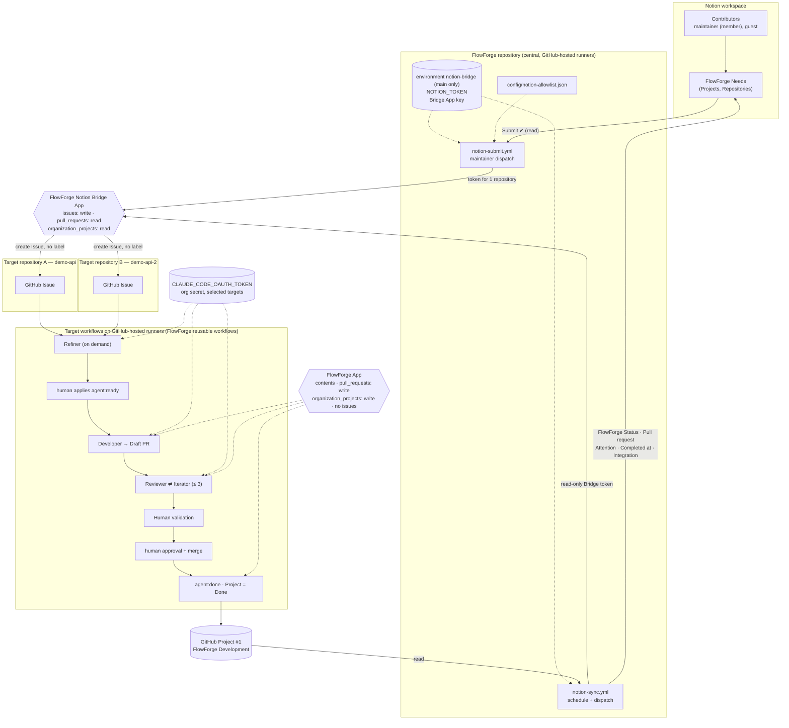

# 🏁 Milestone — Phase 7: Notion integration complete

> **Date**: 2026-10-16 (UTC)
> **Status**: ✅ **PHASE 7 VALIDATED WITH RESERVATIONS** (Prompt 36, closure). Audited on FlowForge
> `main` `af22a70` (PR #56, Prompt 35 milestone, merged 2026-10-16 19:51:44 UTC; working tree clean).
> No code, workflow, permission, secret or Notion schema was changed by the closure: documentation
> only. No blocking reservation (§15.3).
>
> **Prerequisites**: [notion/model.md](../notion/model.md), [notion/provisioning.md](../notion/provisioning.md),
> [notion/submission.md](../notion/submission.md), [notion/feedback.md](../notion/feedback.md),
> milestones [phase7-notion-submission.md](phase7-notion-submission.md) (Prompt 33),
> [phase7-notion-feedback.md](phase7-notion-feedback.md) (Prompt 34),
> [phase7-notion-multiproject-e2e.md](phase7-notion-multiproject-e2e.md) (Prompt 35).

------

## 🧠 Mental Model

```text
  Notion  = WHAT is needed, by whom, for which product      (business input, untrusted)
  GitHub  = HOW it is done, and its true state              (Issue, Project, Actions, PR)
  FlowForge = the only bridge between the two               (2 central workflows, 1 dedicated App)

  Notion ──(once: create the Issue)──► GitHub ──(always: report the state)──► Notion
```

> **Analogy**: Notion is the order desk, GitHub the workshop. The desk writes one work order and
> then only reads the workshop's status board; it never walks onto the floor.

------

## 1. Status

**PHASE 7 VALIDATED WITH RESERVATIONS.** Every exit criterion is `PASS` or `PASS WITH
RESERVATION` (§16); the blocking reservation list is empty (§15.3). Phase 7 is complete and
documented; FlowForge is ready for Phase 8 (not defined yet).

| Prompt | Scope | Date | Result | Evidence |
|---|---|---|---|---|
| 31 | Notion model | 2026-10-12 | done | [model.md](../notion/model.md) |
| 32 | Notion space provisioning | 2026-10-13 | done | [provisioning.md](../notion/provisioning.md) |
| 33 | Notion → GitHub submission | 2026-10-14 | validated with reservations | [phase7-notion-submission.md](phase7-notion-submission.md) |
| 34 | GitHub → Notion feedback | 2026-10-15 | validated with reservations (fix PR #53) | [phase7-notion-feedback.md](phase7-notion-feedback.md) |
| 35 | Multi-contributor / multi-project E2E | 2026-10-16 | validated with reservations | [phase7-notion-multiproject-e2e.md](phase7-notion-multiproject-e2e.md) |
| 36 | Closure audit | 2026-10-16 | **PHASE 7 VALIDATED WITH RESERVATIONS** | this document |

------

## 2. Scope

**In**: Notion as the business intake and high-level tracking layer for several Projects,
repositories and contributors; one-time Notion → GitHub Issue submission; GitHub → Notion status
feedback; isolation, idempotence, refusals, security of the integration.

**Out (unchanged by Phase 7)**: Notion triggering agents, applying labels or merging; automatic
submission; bidirectional sync of all fields; propagation of later edits; the Refiner reading
Notion; one Need fanning out to several repositories; per-Project GitHub Projects; pagination
beyond 100 Needs as a validated path.

------

## 3. Final architecture



What the diagram shows, and only that, was validated live (§14). `GITHUB_TOKEN` (not drawn) is the
caller's workflow-local token: labels, comments, Issue reads in the target workflows.

------

## 4. Data model

Three Notion databases, provisioned by `scripts/notion/bootstrap.sh`; IDs in
[`config/notion.json`](../../config/notion.json); schema in [model.md](../notion/model.md) §5.

| Database | Role | Key properties |
|---|---|---|
| `FlowForge Projects` | functional products; one Project ↔ several repositories | `Name`, `Owners`, `Repositories`, `Active` |
| `FlowForge Repositories` | technical catalogue of GitHub repositories | `GitHub repository` (canonical `owner/name`), `Project` (exactly one), `FlowForge enabled` |
| `FlowForge Needs` | one business need, one target repository | see below |

`FlowForge Needs`, audited against `config/notion.json` (all present):

| Filled by people | Written by the integration |
|---|---|
| `Title`, `Need`, `Project`, `Target repository`, `Requested by`, `Created by` (automatic), `Priority`, `Submit` (+ `Business reason`, `Context`, `Related needs`, never sent to GitHub) | `FlowForge Status`, `GitHub Issue`, `Pull request`, `Integration status`, `Integration message`, `Attention`, `Last synced`, `Completed at` (+ `Need ID`, automatic) |

POC rule: **one Need targets exactly one repository** (relation limit 1, checked at submission).
`FlowForge Status`: `Draft` and `Closed` exist only in Notion; `Backlog` … `Done` mirror the GitHub
Project. `Integration status` (empty / `Pending` / `OK` / `Error`) is technical health, separate.

------

## 5. Sources of truth

| System | Source of truth for | Not the source of truth for |
|---|---|---|
| **Notion** | business need, functional context, `Requested by`, Project, selected Target repository, business priority, `Submit` | technical execution, state, code |
| **GitHub Issue** | the technical unit of work, refined content, agentic lifecycle (`agent:*` label), the link to the Need (`notion-page-id` marker) | business priority |
| **GitHub Project** | FlowForge operational state (`Status`, `Attention`) | — (never starts an agent) |
| **GitHub Actions** | workflow execution, runtime results, execution errors, agent runs | — |
| **Pull request** | implemented code, diff, review, merge state | — |
| **FlowForge Git** | which repositories Notion may target (`config/notion-allowlist.json`) | — (Notion's Repositories rows are a cross-checked picklist) |
| **Notion feedback** | nothing: a **projection** of `FlowForge Status`, `Pull request`, `Attention`, `Completed at`, `Integration status`, `Integration message` | — |

Directions (POC): **Notion → GitHub** = the initial Issue creation only; **GitHub → Notion** =
feedback and state only. No document describes a general bidirectional sync
([model.md](../notion/model.md) §22 lists it as out of scope).

------

## 6. Security and identities

Re-audited live on 2026-10-16 (read-only calls; App installation lists read with a
`metadata: read` installation token, revoked, HTTP 204). No drift since Prompt 35.

| Identity / credential | Where | Responsibility | Audit |
|---|---|---|---|
| **FlowForge Notion Bridge App** (app 5307936, installation 171187017) | key + client ID in FlowForge environment `notion-bridge` | create Issues (submission), read Issues / PRs / Project (feedback) | `issues: write`, `pull_requests: read`, `organization_projects: read`, `metadata: read`; installed on `demo-api`, `demo-api-2` only |
| **FlowForge App** `tipunchlabs-flowforge` (app 5276906, installation 170384259) | org secret `FLOWFORGE_APP_PRIVATE_KEY`, org variable `FLOWFORGE_APP_CLIENT_ID` | agent delivery (push, Draft PRs), Iterator push, Project sync | `contents: write`, `pull_requests: write`, `organization_projects: write`, `metadata: read`, **no `issues`**; installed on `demo-api`, `demo-api-2` only |
| `GITHUB_TOKEN` | each workflow run | workflow-local: labels, comments, Issue reads in the caller repository | per-job minimal permissions |
| `CLAUDE_CODE_OAUTH_TOKEN` | org secret | Claude Code in agent jobs | never in a job holding `NOTION_TOKEN` (the Notion workflows run no agent) |
| `NOTION_TOKEN` | FlowForge environment `notion-bridge` only | read Needs / Projects / Repositories, update Need properties | environment secrets = `NOTION_TOKEN`, `NOTION_BRIDGE_PRIVATE_KEY`; deployment branch policy = `main` |

Targets `demo-api`, `demo-api-2`: no repository secret, no repository variable, no environment;
visible organization secrets = `CLAUDE_CODE_OAUTH_TOKEN`, `FLOWFORGE_APP_PRIVATE_KEY`; visible
organization variables = `FLOWFORGE_APP_CLIENT_ID`, `FLOWFORGE_PROJECT_NUMBER`. **No Notion secret
in any target**, no target workflow mentions Notion. The FlowForge repository itself has no
repository or organization secret besides its environment.

`Requested by` / `Created by` are never read by a script or workflow: a Notion contributor is never
a GitHub identity. The four roles stay distinct: requester (Notion person) ≠ GitHub execution
identity (Apps, `github-actions`) ≠ agent (`claude[bot]` commits) ≠ human reviewer / merger.

------

## 7. Notion → GitHub

`notion-submit.yml` (`workflow_dispatch`, input `notion_page_id`), helper
`.github/scripts/flowforge-notion.sh`; details in [submission.md](../notion/submission.md).

```text
read Need → field checks → coherence Project ↔ Repository → Project Active → FlowForge enabled
→ allowlist (Git) → [only now] Bridge token for that 1 repository → marker lookup → create Issue
→ write back GitHub Issue, Backlog, OK, CREATED → token revoked
```

Results `CREATED` / `LINKED` / `ALREADY_SUBMITTED` / `REFUSED` / `FAILED`. The Issue has the
sanitised title and need, one Bridge marker with the page ID, **no label**: no agent starts.
Live: `NEED-5` → `demo-api#47`, `NEED-6` (injection) → #48 (Prompt 33); `NEED-7` → #49 (Prompt 34);
`NEED-14` → `demo-api#51`, `NEED-12` → `demo-api#52`, `NEED-13` → `demo-api-2#1` (Prompt 35).

------

## 8. GitHub → Notion

`notion-sync.yml` (`schedule` `*/10` + `workflow_dispatch`, one page or all Needs), helper
`.github/scripts/flowforge-notion-sync.sh`; details in [feedback.md](../notion/feedback.md).

| Capability | Live evidence |
|---|---|
| `workflow_dispatch`, one page | Prompts 34, 35 (every transition of `NEED-7`, `NEED-13`, `NEED-14`) |
| All-Needs mode | Prompt 34 run `38801660365` (`NEED-5` / `NEED-6` → `Closed`); Prompt 35 run `38951318824` (7 Needs, 0 written) |
| **Schedule** | Prompt 35 run `38950719805` (2026-10-16 18:52:54 UTC): wrote `Human validation → Done` + `Completed at` on `NEED-14` and `NEED-13`, nothing else |
| Statuses mirrored live | `Backlog`, `Refining` (`NEED-7`), `Ready`, `Developing` (`NEED-7`, `NEED-14`), `Review`, `Human validation`, `Done`, `Closed`; `Attention = Needs clarification` (`NEED-7`) |
| `Pull request` | `demo-api#50`, `demo-api#53`, `demo-api-2#2`, each on its own Need only |
| `Completed at` | merge instants (`NEED-7` 2026-10-15 18:48; `NEED-14` 18:47:31; `NEED-13` 18:48:40), stored at minute precision |

------

## 9. Multi-contributor

| Contributor | Notion role | Needs (`Requested by` / `Created by`) |
|---|---|---|
| maintainer | workspace member | A1 `NEED-14`, X1 `NEED-11` |
| guest | Notion guest invited for Prompt 35 | A2 `NEED-12`, B1 `NEED-13` |

The guest opened Needs, created and edited them, selected both Projects and both repositories and
appeared in `Requested by` (checked by the maintainer in the Notion UI). Both contributors' Needs
followed the same path with the same GitHub identities: multi-contributor did not need a second
GitHub account.

------

## 10. Multi-project / multi-repository

| Need | Project | Target repository | Issue | PR | Outcome |
|---|---|---|---|---|---|
| A1 `NEED-14` | FlowForge POC | `TiPunchLabs/demo-api` | #51 | #53 (merged 18:47:31) | Done |
| A2 `NEED-12` | FlowForge POC | `TiPunchLabs/demo-api` | #52 | none | Ready (by design: no `agent:ready`, no Developer) |
| B1 `NEED-13` | FlowForge POC B | `TiPunchLabs/demo-api-2` | #1 | #2 (merged 18:48:40) | Done |
| X1 `NEED-11` | FlowForge POC | `TiPunchLabs/demo-api-2` ✗ | none | none | `REFUSED` (cross-project) |

Isolation (Prompt 35 §11): each target only ran workflows for its own Issues and PRs; each `main`
moved only by its own human merge (`demo-api` `0202234` → `92716a0`, `demo-api-2` `ab8c23a` →
`a5eb53a`); every PR closes only its own Issue; every Need links only its own PR. **No
cross-repository write was observed.** Both repositories share the organization Project #1:
isolation rests on Issue-level correlation, not on separate Projects.

------

## 11. Idempotence

| Operation | Evidence |
|---|---|
| Submit: 1 Need → 1 Issue | every live submission created exactly one Issue (Prompts 33–35) |
| Resubmit → `ALREADY_SUBMITTED`, no second Issue | `NEED-5` (Prompt 33); A1 `NEED-14` run `38832283516` (Prompt 35), Bridge token step skipped |
| Aligned sync → `UNCHANGED`, `changed=[]`, no write | Prompt 34 runs `38794178314`, `38794226674` (after fix PR #53); Prompt 35 at Ready (`38926171243`), Human validation (`38943570501`), Done (`38951040741`, `38951086878`, `38951136439`, `38951188169`) |
| All-Needs → no write when aligned | `38951318824`: `NEED-5`–`NEED-7`, `NEED-12`–`NEED-14` `UNCHANGED`, `NEED-8` `REFUSED` without rewrite |
| `Completed at` stable, `Pull request` stable | the four Done reruns kept `18:47` / `18:48` and PR #53 / #2; compared as instants at minute precision since PR #53 (the Prompt 34 defect) |

------

## 12. Anti-corruption / refusal

| Protection | Where | Live evidence | Otherwise |
|---|---|---|---|
| Target repository not attached to the Need's Project (mismatch) | submit, **before** any GitHub token | X1 `NEED-11` (Prompt 35); `NEED-4` (Prompt 33) | — |
| Project not Active | submit, before token | — | `tests/notion-submit.sh` |
| Repository not FlowForge enabled | submit, before token; sync | — | tests |
| Repository not in the Git allowlist | submit, before token; sync | — | tests |
| Not exactly one Project / Target repository, empty or oversized text, bad priority | submit, before token | — | tests |
| Need without Issue | sync | X1 run `38832589688` | tests |
| Issue URL vs Target repository mismatch | sync | `NEED-8` (Prompts 34, 35) | tests |
| Issue not created by the Bridge, marker absent / invalid / other page ID | sync (author + marker) | — | tests |
| Issue deleted / transferred / is a PR | sync | — | tests |
| Need already submitted | submit (`GitHub Issue` set, then marker lookup) | `ALREADY_SUBMITTED` (§11) | `LINKED` recovery: tests |
| Notion text as untrusted input | sanitised and capped; destination from relations + allowlist only | `NEED-6` injection → Issue in `demo-api` only (Prompt 33) | tests |

Refusals are explicit (`REFUSED: <reason>` in the run summary and `Integration message`),
non-destructive (`FlowForge Status`, `Pull request`, `Attention`, `Completed at` never touched),
idempotent (not rewritten while unchanged), never write to an invalid repository, and the
submission refuses before minting any GitHub token (X1: token and delivery steps skipped).
No new destructive test was run for the closure.

------

## 13. Human validation

```text
Reviewer APPROVE ──► Human validation ──► a human inspects, approves ──► human merge ──► Done
   (agent opinion)      (Project state)       (the real decision)          (ruleset)
```

An agent `APPROVE` only moves the card to `Human validation`; it is never a merge decision. The
default-branch ruleset requires a pull request and an approval; agents open Draft PRs only and
never merge. Live: `demo-api#53` and `demo-api-2#2` were marked ready for review, approved and
merged by the maintainer (`xgueret`, 18:46–18:48 UTC), and only then did the lifecycle set
`agent:done` and the Project `Done`; earlier `demo-api#50` (Prompt 34). `agent:ready` was applied by
a human every time.

------

## 14. Evidence summary

| Evidence | Prompt | Reference |
|---|---|---|
| Submission `CREATED`, `ALREADY_SUBMITTED`, injection contained, mismatch `REFUSED` | 33 | [phase7-notion-submission.md](phase7-notion-submission.md) |
| Full feedback chain Backlog → … → Done on `NEED-7`, `Needs clarification`, `Closed`, idempotence fix | 34 | [phase7-notion-feedback.md](phase7-notion-feedback.md) |
| Two contributors, two Projects, two repositories, cross-project refusal, two real lifecycles, two human merges, schedule → Done, all-Needs | 35 | [phase7-notion-multiproject-e2e.md](phase7-notion-multiproject-e2e.md) |
| Iterator live (`REQUEST_CHANGES` → `COMPLETED` → `APPROVE`, card `Review → Iteration → Review`) | 29.2 (Phase 6) | [phase6-github-projects-e2e.md](phase6-github-projects-e2e.md) §17 |
| Security and identities re-audit | 36 | §6 |
| Offline tests | 33–34 | `tests/notion-submit.sh`, `tests/notion-sync.sh` (pre-commit, CI) |

------

## 15. Reservations

### 15.1 Resolved

| Reservation (origin) | Resolved by |
|---|---|
| A second target repository (Prompt 34) | `demo-api-2`, Prompt 35 |
| Multi-project | Prompt 35 (FlowForge POC, FlowForge POC B) |
| Real multi-account collaboration (Prompt 32) | Prompt 35 (Notion guest) |
| Cross-project refusal in a real two-Project setup | Prompt 35 (X1) |
| Schedule never fired (Prompt 34) | Prompt 35 run `38950719805` |
| Merge → `Done` and `Completed at` | Prompts 34, 35 |
| All-Needs mode | Prompts 34, 35 |
| Rerun on `Done` not idempotent (Prompt 34 live defect) | fix PR #53, reruns `UNCHANGED` in Prompts 34–35 |
| Integration values written but not read back (Prompts 33, 34) | read back by the maintainer in the Notion UI in Prompt 35 (see 15.2: manual) |
| Test Issues `demo-api#47`, #48 left open (Prompt 33) | closed (Need → `Closed` in Prompt 34) |

### 15.2 Accepted / non-blocking

| Reservation | Why it does not block |
|---|---|
| `Refining` not observed in Notion during Prompt 35 (Refiner ≈ 80 s, faster than the sync) | observed on the Project cards in Prompt 35 and in Notion in Prompt 34 (`NEED-7`); short states may be skipped by design ([feedback.md](../notion/feedback.md) §12) |
| B1 `Developing` not observed in Notion | A1 `Developing` observed in Notion; B1's card observed `Developing`; same design note |
| Iterator not exercised in Prompt 35; `Iteration` never seen in Notion | Iterator validated live in Phase 6 (Prompt 29.2); mapping covered by `tests/notion-sync.sh` |
| `Attention = Blocked / Max iterations / Failed`, `Closed` as *duplicate* | tests only |
| `FAILED` paths, `LINKED` recovery, concurrency, App not installed, non-`main` run denied secrets | tests and configuration only |
| Pagination > 100 Needs | tests only; fewer than 100 Needs exist |
| Irregular schedule cadence: cron `*/10`, observed scheduled runs hours apart (01:25, 06:04, 11:14, 15:23, 18:52 UTC on 2026-10-16) | GitHub scheduling delay; on-demand dispatch exists; cron unchanged |
| A1's human-activity Reviewer published `APPROVE` 4 s after the merge (closed-PR `NO_OP` check at start only) | comment only, no state change |
| Some Notion values verified manually in the UI (Integration messages, `Requested by`, X1 `Submit`) | the integration has no read-back report; the maintainer read them |
| One shared GitHub Project for all Projects | design choice (model §5.1); isolation holds at Issue level |
| Submission is maintainer-started (`workflow_dispatch`) | POC choice (model §10.2) |

### 15.3 Blocking

None.

------

## 16. Exit criteria

| # | Criterion | Result | Evidence |
|---|---|---|---|
| 1 | Notion data model validated | PASS | §4, model.md, `bootstrap.sh --check` (Prompt 32) |
| 2 | Notion → GitHub Issue validated | PASS | §7, Prompts 33, 35 |
| 3 | GitHub → Notion feedback validated | PASS WITH RESERVATION | §8; `Iteration` and some `Attention` values tests only |
| 4 | Submit idempotent | PASS | §11 |
| 5 | Sync idempotent | PASS | §11 |
| 6 | Cross-project refusal validated | PASS | §12 (X1) |
| 7 | Multi-contributor validated | PASS WITH RESERVATION | §9; person fields checked in the UI |
| 8 | Multi-project validated | PASS | §10 |
| 9 | Multi-repository validated | PASS | §10 |
| 10 | Refiner validated | PASS | Prompt 35 §9 (3 × `READY`), Prompt 34 (`NEEDS_CLARIFICATION`) |
| 11 | Developer validated | PASS | Prompt 35 §8 |
| 12 | Reviewer validated | PASS | Prompt 35 §9 |
| 13 | Iterator validated at project level | PASS WITH RESERVATION | Phase 6 §17; not replayed in Phase 7 |
| 14 | Human validation validated | PASS | §13 |
| 15 | Human merge validated | PASS | §13 |
| 16 | Merge → Done validated | PASS | §8, §13 |
| 17 | Completed at validated | PASS | §8, §11 |
| 18 | Scheduled sync observed | PASS WITH RESERVATION | §8; irregular cadence |
| 19 | All-Needs reconciliation validated | PASS WITH RESERVATION | §8, §11; no pagination |
| 20 | Isolation validated | PASS | §10 |
| 21 | Apps / secrets validated | PASS | §6 |
| 22 | Anti-corruption validated | PASS WITH RESERVATION | §12; several refusals tests only |
| 23 | Documentation aligned | PASS | Prompt 36 changes (README, architecture §2.12 / §5.9, model, provisioning, onboarding §7, issue contract) |
| 24 | Reservations documented | PASS | §15 |
| 25 | No blocking reservation | PASS | §15.3 |

------

## 17. Final decision

**PHASE 7 VALIDATED WITH RESERVATIONS.** The Notion integration is complete for the POC:
architecture, sources of truth, data model, identities, refusals, idempotence and the human gate
are validated live and documented, and every remaining reservation is classified non-blocking.

- **Next**: Phase 8, not defined yet.
- **Tag**: `flowforge-phase7-notion-e2e`, annotated, on the merge commit of the closure PR, created
  by a maintainer after the merge (same practice as Phases 5 and 6).

------

> **Document created on**: 2026-10-16
> **Author**: FlowForge maintainers, with Claude Code
> **Version**: 1.0 — Phase 7, Prompt 36 (closure)
